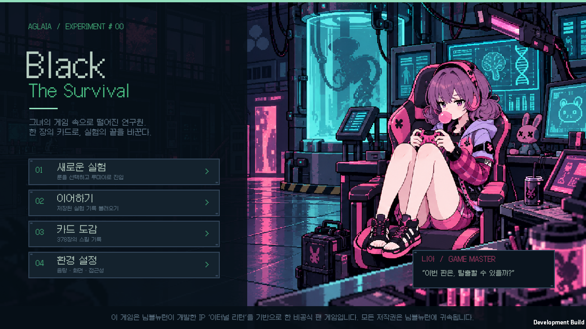

# Black The Survival

연구원 **하나**가 **니아의 VF 게임 월드**에 들어가 탈출하는 도트 그래픽 덱 빌딩 팬 게임. Unity **6000.3.11f1**에서 구현했습니다.

## 실행

- [Windows 다운로드](https://github.com/JSKS17/BlackTheSurvival/releases): ZIP을 폴더에 모두 압축 해제한 뒤 `BlackTheSurvival.exe`를 실행하세요. 최신 정식 버전은 [v1.0.27](https://github.com/JSKS17/BlackTheSurvival/releases/tag/v1.0.27)에 있습니다.
- [웹에서 플레이](https://bser-sts.com): 계정별 진행 기록과 환경 설정을 저장하며 Windows와 같은 게임 규칙을 사용합니다.
- 웹 v1.0.28에서는 로비 로고 오른쪽 위에 현재 접속자 수를 표시합니다. 로그인한 게임 접속 계정을 중복 없이 집계하며, 종료된 접속은 최대 90초 뒤 제외합니다.
- 웹 v1.1.0에서는 선택한 룬 계열에 맞는 공식 역할군 실험체의 스킬·패시브 추첨 가중치를 4배로 높입니다. 파괴(빨강)는 전사·원거리 딜러, 저항(파랑)은 탱커·전사, 혼돈(보라)은 스킬 딜러·암살자, 지원(초록)은 탱커·지원가에 적용합니다. 복수 역할군을 반영하며 기존 보유 패시브의 스킬 등장 보정과 함께 적용합니다. [공식 역할군 자료](docs/rune-roles-1.1.0/official-roles.json)를 참고하세요.
- 소스에는 Unity 프로젝트와 제작·검증 자료가 포함됩니다. Unity 캐시·개인 환경 설정·빌드 출력·개인 이어하기 저장은 포함하지 않습니다. Unity **6000.3.11f1**에서 프로젝트 루트를 열면 됩니다.
- Unity에서 이 프로젝트를 열고 **Play**를 누르면 로비가 나타납니다. `SampleScene`에 오브젝트를 직접 배치할 필요 없이 런타임 부트스트랩이 게임을 시작합니다.
- 완성된 Windows 빌드가 있으면 `Build/Windows/BlackTheSurvival.exe`를 실행하세요. 같은 폴더의 `BlackTheSurvival_Data`, `MonoBleedingEdge`, `UnityPlayer.dll`도 함께 있어야 합니다.

## 모드와 로비 대사

로비의 **새로운 실험**에서 **노말·하드·무한**을 선택하고 시작을 확정합니다. 노말 탈출에 성공하면 하드, 하드 탈출에 성공하면 무한이 열립니다. 이전 버전에서 탈출한 연구 프로필은 노말 클리어로 인정해 하드를 열어 주며, 무한은 하드를 실제로 클리어해야 열립니다. 해금은 종료 정산이 영구 연구 프로필에 저장된 뒤 적용됩니다.

하드는 적 체력 25%·직접 공격 피해 10% 증가 규칙을 사용합니다. 무한은 하드 규칙으로 시작하고, 3막 보상과 패시브 선택을 마치면 성장과 덱을 유지하며 다음 3막 주기로 이어집니다. 주기마다 적 체력은 20%p·직접 피해는 5%p 증가하고 두 번째 주기부터 적 레벨은 20입니다. 보스 처치의 최대 코스트 증가는 총 +6까지이며 조우 보너스는 별도입니다. 무한 원정의 **메뉴 → 무한 원정 정산**에서 자발 종료하거나 패배하면 누적 연구 성과를 정산합니다. [모드 규칙과 저장·정산](docs/RUN_MODES.md)을 참고하세요.

로비 오른쪽 니아의 말풍선을 누르면 팁과 농담이 **무작위**로 바뀝니다. 대사 **48개**를 모두 한 번씩 본 뒤 다시 섞으며 바로 같은 대사가 반복되지 않습니다. 대사 클릭은 원정의 난수나 저장 상태를 바꾸지 않습니다. [전체 대사와 작성 근거](docs/LOBBY_DIALOGUE.md)를 보관합니다.

로비는 연구소 배경과 니아를 별도 이미지로 표시합니다. v1.0.1에서는 연구소를 굵은 도트로 다시 만들고 256×144 Point 표시로 니아와 도트 크기를 맞췄습니다. 프롤로그 두 번째 컷의 니아도 눈과 입을 절제된 무표정으로 교정했습니다. v1.0.2에서는 두 번째 컷 니아의 양쪽 눈과 입을 더 자연스럽게 다듬었습니다. [최신 아트 제작 기록](docs/art-refresh-v1.0.3/README.md)을 참고하세요.

승인한 **실험체 91명의 R 도트 애니메이션**을 플레이어와 상대 모두에 적용했습니다. v1.0.1에서는 배경 패널 없이 시전자 쪽에 더 크게 띄우고 중앙 카드와 동시에 재생합니다. 손패·확대 카드와 겹치지 않으며 R로 전투가 끝나도 연출을 마친 뒤 결과 화면으로 넘어갑니다. 피해·보호막·패시브 등의 숫자와 문구에는 테두리와 별도 표시 줄을 적용해 조금 더 오래 보여 줍니다. 원본·프롬프트·GIF·WebP와 [프레임별 감상 갤러리](docs/ART_ULTIMATE_COLLECTION.md)는 `ArtSource/AnimationPrototypes/`에 보관합니다. [게임 적용 방식과 자산 규약](docs/ULTIMATE_ANIMATIONS.md)을 참고하세요.

전투 중 음식은 **만년 스프 2코스트, 다른 음식 1코스트**를 사용하며 전투 밖에서는 비용이 없습니다. 바냐 Q·비앙카 W·클로에 E·매그너스 W의 무료 연계는 다음 자기 턴에 열립니다. [음식과 지연 연계](docs/FOOD_AND_DELAYED_RECASTS.md)를 참고하세요. 장비는 57종이며 무기 23개 계열을 모두 지원하고, 추가한 치명타 장비의 피해 보너스는 기본150% 배율에 합산합니다.

선택형 기믹을 **18종 카드**에 연결했습니다. 시셀라 E는 자신 방어와 적 공격 중 대상을 선택하고, 일레븐 Q·W·E·에이든 W·펠릭스 R은 즉시 사용하거나 비용을 미리 지불해 다음 자기 턴부터 무료로 발동합니다. 충전한 사본은 사용할 때까지 보존되고 새로 뽑는 손패 한 칸을 차지합니다. 아디나 R은 다음에 뽑을 카드 3장을 보고 손패와 교환하며, 타지아 R·에키온 W는 다른 손패를 최대 3장 선택해 이번 전투에서만 소멸시키고 피해·방어도를 높입니다. 에바 R·쇼우 R은 **X 코스트**로 남은 코스트를 모두 투자합니다. 시셀라 R·키아라 W·레녹스 Q에는 자신의 체력이나 방어도 계수가 있습니다. 클로에의 니나는 별도 체력 18을 사용해 일반 피해의 25%, R의 생명 공유 중에는 50%를 분담하며 파괴되면 지원이 종료됩니다. 선택창에서 취소하거나 선택을 바꿀 수 있고, 강화·충전·저장은 실제 카드 사본별로 유지됩니다. [전체 효과·수치·원작과의 연결](docs/ADVANCED_CARD_MECHANICS.md)을 참고하세요.

## 니아의 튜토리얼과 스토리

새 원정의 프롤로그 **4컷**과 노말·하드의 엔딩은 아직 감상하지 않은 이야기만 자동으로 재생합니다. 끝까지 보거나 건너뛰면 원정과 별도로 감상 기록을 저장하므로 새 게임에서도 다시 뜨지 않으며, 로비의 **이야기 다시 보기**에서 감상할 수 있습니다. 도중에 저장하고 로비로 나간 이야기는 저장한 컷부터 이어봅니다. 첫 준비 때 니아의 짧은 연습 전투를 선택할 수 있으며 로비의 **니아의 튜토리얼**에서 언제든 다시 배울 수 있습니다. 기본 공격·경계·턴 종료·상대 행동·니아 Q/W의 블록 연계·0코스트 사용·필드 확인을 실제 카드 규칙으로 연습합니다. 연습은 별도 엔진에서 진행하므로 기존 이어하기·연구·크레딧을 바꾸지 않습니다.

노말·하드 탈출에는 각각 **4컷** 엔딩이 있습니다. v0.1.26부터 큰 배경 6종, 컷신 전용 캐릭터 12종, 말풍선 틀, 내레이션·대사를 독립적으로 관리하고 컷 전환 때 함께 표시합니다. 니아 8종·하나 4종은 기존 게임의 도트 스타일과 복장을 바탕으로 각 장면에 맞는 표정과 포즈를 새로 만들었습니다. 이전·다음·건너뛰기·저장 후 로비를 지원하고 기존 저장의 컷 위치부터 이어집니다. 로비의 **이야기 다시 보기**에서는 프롤로그와 이미 해금한 모드의 엔딩을 다시 감상합니다. 기존 종료 기록에는 엔딩을 소급 재생하지 않습니다. [캐릭터 아트와 프롬프트](docs/ART_LAYERED_STORY_CHARACTERS.md), [배경 아트와 프롬프트](docs/ART_LAYERED_STORY_BACKGROUNDS.md), [화면과 저장 검증](docs/validation-layered-story/README.md)을 참고하세요.

전투 손패 오른쪽 위 **?**는 실제 코스트·사용 불가 이유·조건의 현재 수치·무료 사용권·피해 예상·보스 제한을 보여줍니다. **전투 기록**에는 양측 카드 사용과 실제 체력 피해·방어 흡수·회피·회복·패시브·상태 효과가 남습니다. 최근 240개 기록을 이어하기에 저장하며, 현재 전투/원정 전체와 주체·종류로 걸러볼 수 있습니다. 이전 버전에서 발생한 행동은 복원하지 않습니다.

## 원정 사이에 남는 연구 기록

승리·패배 후 완료한 구역과 전투, 보스 처치·공략, 탈출, 새로운 관측·과제·교차 연계를 **관측 데이터**로 정산합니다. 로비의 **연구 기록**에서 91명의 관측·Q/W/E/R 기술 연구·고유 실험 진척을 확인합니다. 과제 세 개를 달성하고 데이터 500으로 보고서를 완성하면 실험체별 **레어 조우**를 해금합니다. 레어 조우는 다음 원정부터 등장하며 기존 약속 후속 조우의 우선권을 유지합니다. 시작 준비 단계의 선택은 늘어나지 않습니다.

레어 조우 91종은 최신 출시 스킨에서 착안한 창작 이야기와 전용 도트를 사용합니다. 루치아·세레스·크레이버는 각각 새로 디자인한 사복을 입습니다. 해금한 실험체의 일반 조우 후보를 대체하는 확률은 **1막 12%·2막 18%·3막 이후 25%**이며, 한 막에 한 번만 후보로 나타납니다. 일반 신호가 레어 신호와 스킨 도트로 전환되는 연출을 제공합니다. 각 사건의 세 선택지는 전용 `++` 카드 구매, 실험체 패시브 또는 R, 카드 최대 2장 제거·추가 보조 룬·저비용 일반 카드 복제·무작위 F 보상으로 구성합니다. [레어 조우 보상과 저장 규칙](docs/RARE_ENCOUNTERS.md)을 참고하세요. [스킨·프롬프트·아트 검증 기록](docs/art-rare-skins/README.md)과 [게임 화면 검증](docs/validation-rare-skins/README.md)을 참고하세요.

연구 프로필은 `bts-research-v1.json`에 원정과 별도로 저장합니다. 새 게임으로 원정 기록을 바꾸어도 연구는 남으며, 같은 종료 기록을 불러와도 보상은 한 번만 받습니다. [연구 규칙과 보상](docs/RESEARCH_PROGRESSION.md), [실제 검증 기록](docs/validation-research/README.md)을 참고하세요.
- Unity 메뉴 **Black The Survival → Build Windows game**으로 다시 빌드할 수 있습니다.

전술 스킬(F)은 초월을 제외한 일반·코발트 출신 26종을 제공합니다. 일부 조우의 전술강화 모듈은 가방에서 선택한 F 카드 한 장만 강화하며, 캐릭터별 전술 카드 거래도 지원합니다. [전체 목록과 강화 효과](docs/TACTICAL_SKILLS.md)를 참고하세요.

## 플레이

1. 메인 룬과 같은 계열 보조 룬을 각각 하나 선택합니다.
2. 제시된 패시브 3개 중 하나를 고릅니다. 선택지 리롤은 2번입니다. 보유 패시브 주인의 Q/W/E/R 스킬은 시작 카드·카드 리롤·야생동물 보상의 무작위 선택지에서 추첨 가중치가 1.5배가 됩니다. 여러 패시브의 주인에게 각각 적용되며 같은 주인은 중첩되지 않습니다.
3. 코스트 0~4인 스킬 카드 6개 중 3장을 고릅니다. 리롤은 2번이며 이미 선택한 카드는 그 위치에 남습니다. 기본 공격 5장과 경계 3장이 함께 들어갑니다.
4. 분기 지도에서 빛나는 연결 구역을 클릭합니다. 한 주기는 각 막 12구역, 총 36구역을 진행합니다. 지도를 가로로 스크롤하여 경로를 확인하세요.
5. 전투에서 손패를 클릭합니다. 카드 코스트는 0~7이며, 최대 코스트는 5로 시작해 보스 승리마다 1 증가합니다. 무한 모드의 보스 보상은 합계 +6이 상한입니다. 일부 실험체 조우에서도 영구적으로 1 올릴 수 있으며 이 보너스는 별도입니다. 레벨 상승은 최대 코스트를 올리지 않습니다. 쿨다운 초기화는 대상 카드의 이번 턴 무료 사용권으로, 일부 쿨다운 감소는 다음 사용의 코스트 할인으로 변환했습니다. 할인 후 코스트가 0이거나 무료 사용권이 있으면 남은 코스트가 0이어도 사용할 수 있습니다. 상세 설명에서 연계 대상을 확인하세요.
6. 일반 실험체와 보스에게 승리하면 카드의 코스트와 관계없이 **최대 2장**을 선택합니다. 야생동물 보상은 획득 코스트 예산 안에서 선택하며, 0코스트 카드의 획득 가격은 1입니다. 선택한 카드를 다시 누르면 취소되고 다른 카드로 바꿀 수 있습니다. **선택 확정**을 눌러야 덱에 추가되며, 0장이나 1장만 선택하고 진행할 수도 있습니다. 야생동물 승리 시 기존 기술 선택지 3장에 더해 3% 확률로 기본 공격 1장이 선택지에 추가되고, 독립적으로 50% 확률로 고기 1개를 가방에 받습니다. 아야·현우·유키·아이작·리오·마커스의 기본 조우와 엠마·피오라의 후속 조우에서도 기본 공격 1장을 얻는 행동을 고를 수 있습니다.
7. 키오스크에서 재료·음식을 구매하고 모닥불에서 장비를 제작하거나 요리하세요. VF혈액샘플은 두 번째 보스 승리 후 구매할 수 있고, 만년 스프와 완성 요리는 키오스크에서 판매하지 않습니다. 모닥불에서는 휴식과 제작·요리 중 하나를 선택합니다. 휴식은 체력 전체 회복·만년 스프 1개·원하는 카드 최대 2장 제거를 제공합니다. 제작·요리는 체력을 자동 회복하지 않으며 합쳐 최대 3회입니다. 장비 이름 검색과 옵션 태그를 함께 사용하여 원하는 장비를 찾을 수 있습니다. 오른쪽 상단 **덱 / 장비 / 가방**에서 회복 아이템을 사용합니다.
8. 노말·하드는 마지막 보스 니아를 이기고 보상을 마치면 탈출합니다. 무한은 증강 선택과 장비 장착 한도 확장을 마친 뒤 다음 주기로 이어집니다. 체력이 0이 되면 실험이 종료됩니다.

무한 모드에서 3막 니아의 카드·패시브 보상을 마치면 **같은 등급의 증강 후보 3개 중 하나**를 선택합니다. 보통·희귀·전설 각 9종, 총 27종이며 첫 세 번은 이 순서로 등급을 보장하고 이후에는 25%·45%·30% 확률로 등급을 추첨합니다. 조건부 공격·방어·드로우·코스트 효과는 최대 3중첩으로 누적하고 크레딧·회복·최대 체력 지원은 반복해서 선택할 수 있습니다. 선택한 후보를 다시 누르면 취소되고 **선택 확정**을 눌러야 적용됩니다. 건너뛰기도 가능하며 보유 효과는 **증강** 버튼과 가방의 증강 탭에서 확인합니다. 이어서 원하는 장비 부위 하나의 장착 한도를 1 늘립니다. 기본 한도는 부위당 2이며 같은 부위를 반복 선택할 수 있습니다. 장비를 바로 지급하지는 않으며 모닥불에서 제작해 추가 장착합니다. 선택 단계와 부위별 한도는 저장·이어하기에도 유지됩니다. [전체 27종과 적용 규칙](docs/ENDLESS_AUGMENTS.md)을 보관합니다.

1·2막의 상·중·하 보스 구역은 서로 다른 실험체이며 두 막의 여섯 보스도 중복되지 않습니다. 3막은 세 경로 모두 최종 보스 니아입니다. 지도 아래 각 ACT 패널의 **상·중·하**를 선택하면 해당 경로의 보스 이름·도트 스프라이트·공략·처치 여부를 확인할 수 있습니다. 실제 전투는 연결된 경로에서 선택한 보스와 진행하며 미리보기 선택으로 현재 위치를 바꾸지는 않습니다. 배정은 원정 생성 때 저장하고 지도 확인·이어하기로 다시 뽑지 않습니다. 이전 저장은 처치한 보스와 진행 중인 전투·보상을 실제 경로에 보존하여 보완합니다.

지도 하단 보스의 **공략**을 누르면 실험체별 페이즈와 특수 행동의 대응 방법을 확인합니다. 91명의 보스는 체력 50% 이하에서 두 번째 페이즈를 준비하고, 니아는 25% 이하에서 세 번째 페이즈도 준비합니다. 전환은 다음 플레이어 턴에 적용됩니다. 대응 조건은 11종이며 디버프 기술 사용·금지, 고위력 공격 금지, 이동 기술 금지도 포함합니다. 금지형은 예고 턴에 카드를 최소 2장 사용하면서 금지를 지켜야 하며 턴 종료에 성공을 판정합니다. 한 번 위반하면 그 턴에는 되돌릴 수 없습니다. 다른 누적형 조건에는 피해 또는 방어도 대체 목표를 제공합니다. 성공하면 특수 행동을 저지하고 다음 플레이어 턴까지 공격 기회를 얻습니다. [실험체별 보스 설계](docs/BOSS_MECHANICS.md)에 판정 범위와 모든 기믹을 정리했습니다. 키오스크와 직접 연결된 인근 전투 구역은 구역 아이콘 오른쪽 아래의 작은 키오스크 아이콘으로 표시합니다.

다른 실험체의 카드가 서로 보완하는 [8종 교차 연계](docs/CROSS_SUBJECT_SYNERGY_PLAN.md)를 적용했습니다. 에키온·블레어의 VF 공명, 아이솔·로지·셀린·테오도르의 폭파 연계와 기름 점화·상처·넉백·기동·꽃과 나비·보호 지원을 사용할 수 있습니다. 고유 자원을 유지하며 외부 효과에 턴당 횟수와 추가량 제한을 적용합니다. 무료 카드는 준비를 소비할 수 있지만 새 외부 준비를 만들지 않습니다. 조건은 카드 상세에서, 준비와 이번 턴 제한은 필드 효과에서 확인하세요.

덱의 핵심 카드와 다음 경로를 계획할 수 있도록 다음 기능을 제공합니다.

- **선택형 카드 강화:** 조우에서 카드 강화 행동을 고르면 덱의 카드 한 장과 강화 방향을 직접 선택합니다. 효과를 미리 보고 **선택한 강화 확정**을 누르세요. 선택한 사본만 강화되며 같은 종류의 다른 카드나 이후 획득한 카드는 일반 상태로 유지됩니다. 다른 사본은 별도로 다른 방향을 선택할 수 있습니다. 강화 카드는 금색 테두리·이름의 `+`·강화 배지로 구분하고, 덱·손패·상세·사용 전 정보에 그 사본의 효과를 표시합니다. 출력 강화와 코스트 절약 중 선택할 수 있는 카드가 있고, 니아 Q/W에는 블록을 강화하는 전용 방향이 있습니다. 무기 카드는 대상에서 제외하며 강화 없이 진행할 수도 있습니다. 기존 저장에서 이미 적용된 강화는 현재 보유 사본에 보존됩니다.
- **손패 보관:** 전투의 **카드 보관**을 누른 뒤 다음 턴까지 남길 손패 1장을 고릅니다. 같은 카드를 다시 누르면 해제되고, 턴 종료 전까지 바꿀 수 있습니다. 보관은 전투당 2회이며 턴 종료 때 횟수를 사용합니다. 다음 턴에는 보관한 카드와 함께 새 카드를 한 장 적게 뽑습니다.
- **보안 콘솔과 하이퍼루프:** 지도에서 보안 콘솔을 막당 한 번 **40크레딧**에 사용해 다음 두 단계의 실험체·야생동물과 키오스크 재고를 확인합니다. 하이퍼루프는 막당 한 번, 바로 다음 단계에서 현재 위치와 연결되지 않은 구역으로 이동합니다. 목적지 선택만 취소하면 횟수를 쓰지 않습니다.
- **다시 만나는 실험체:** 쇼우·레녹스·엠마·니아·알렉스·캐시·피오라·테오도르에게는 약속으로 이어지는 후속 조우가 있습니다. 약속 선택지의 비용과 즉시 보상을 확인하세요. 새로 약속한 실험체의 후속 이야기는 다음 실험체 조우의 세 선택지에 **80% 확률**로 등장합니다. 만나지 못하거나 다른 이야기를 선택해도 약속은 남습니다. 미해결 약속이 여러 개면 우선권을 순환하며, 각 후속 보상은 한 번만 받습니다.

정확한 강화 수치와 인물별 약속, 저장 호환 규칙은 [전략 시스템 설명](docs/STRATEGY_SYSTEMS.md)에 정리했습니다.

## 구현 범위

| 요소 | 현재 내용 |
|---|---|
| 모드 | 노말 탈출 → 하드 해금 → 하드 탈출 → 무한 해금. 무한은 덱과 성장을 유지하며 3막 주기 반복·자발 정산 |
| 구역 | 야생동물, 실험체, 키오스크, 모닥불, 실험체 조우, 보스 |
| 야생동물 | 닭, 들개, 멧돼지, 늑대, 곰. 회피율 0%, 동물별 오브젝트 드롭 규칙 |
| 카드 | 392장: Q/W/E/R 364장, 기본 2장, 무기 23장, 전술 3장. 모든 미리보기의 공통 요약과 상세 창의 요약·전체 설명 전환 |
| 전투 실험체 | 91명. 기본 공격·방어, 자기 Q/W/E/R·무기군 D·무작위 F·자기 패시브. 레벨 8부터 장비, 후반·보스는 최대 5부위 |
| 보스 | 1·2막 경로별 다른 보스·3막 니아, ACT별 상·중·하 미리보기. 91명 고유 공략·2페이즈, 니아 3페이즈. 대응 11종·특수 행동·위반 표시 |
| 실험체 이벤트 | 기본 조우 91종 + 약속으로 열리는 후속 조우 8종 + 연구 보고서로 열리는 스킨 테마 레어 조우 91종, 각각 행동 3개로 총 570개 행동. 캐릭터별 상황·비용·보상·다음 만남을 표시하며 고정 카드는 이름·슬롯·코스트와 상세 미리보기 제공 |
| 패시브 | 실험체 91명의 패시브. 최대 3개, 보스 보상에서 획득·교체·포기. 주인 스킬의 무작위 등장 가중치 1.5배 |
| 룬 | 메인 8개, 보조 8개. 같은 계열 선택, 특정 이벤트에서만 변경 |
| 장비 | 전설·초월 51개. 무기·옷·머리·팔/장식·다리 각각 기본 2개까지 착용. 무한은 3막마다 한 부위의 한도를 1 확장. 치명타 관련 장비와 10종 옵션 태그 검색 |
| 음식 | 14종. 원재료 5종의 모닥불 조리와 완전 회복 만년 스프 |
| 레벨 | 플레이어·상대 최대 20. 플레이어 최대 코스트는 시작 5 + 보스 승리·조우의 영구 보상이며 무한의 보스 성장 상한은 +6. 상대의 최대 코스트는 레벨에 따라 5~8 |
| 그래픽 | 80×80 논리 격자를 160×160으로 확대한 기본 치비 스프라이트 92개와 레어 조우 전용 스킨·사복 91개. 카드 392종·패시브 91종, 룬 16종·오브젝트 5종·장비 51종·크레딧·모닥불·지도 4종의 전용 도트 아이콘. 니아 로비, 전투 배경, 야생동물·음식 도트 그림과 한글 도트 글꼴 |
| 로비 | 모드를 선택하는 새 게임, 이어하기, 환경 설정, 검색 가능한 카드 도감, 클릭하여 순환하는 니아의 창작 대사 48개, 요청한 IP·저작권 문구 |
| 저장 | 행동마다 자동 저장. 손패·버린 카드·상대 행동·난수 상태까지 복원 |
| 전투 연출 | 양측 카드 확대 표시와 승인된 실험체 91명의 전용 R 도트 애니메이션. 손패 분리·마지막 R 뒤 결과 표시·창 일시 정지. 원작 기술 특징을 참고한 32계열 도트 공격, 돌진·후퇴·도약·순간이동·회전과 잔상·피격 반응. 적 카드도 순차 재생. 움직임 줄이기 지원 |

카드를 사용하면 스킬 아이콘·실험체·기술 키·카드명이 약 0.3초 동안 확대되어 나타납니다. 원작 기술과 저장된 원본 아이콘을 참고하여 392종에 32계열 공격 모양과 개별 팔레트를 적용하고, 준비·이동·타격·소멸 순서로 재생합니다. 플레이어와 상대 실험체 모두 돌진·후퇴·도약·순간이동·회전 움직임과 잔상·피격 반응을 사용합니다. 지속 피해·패시브·룬·장비 발동은 별도 작은 효과로 구분하고 카드 확대를 반복하지 않습니다. 움직임 줄이기 설정에서는 확대·이동·회전·잔상 없이 고정 안내와 숫자만 표시합니다. [원작 참고와 연출 규칙](docs/COMBAT_VISUALS.md)을 보관합니다.

기본 92종과 레어 스킨 91종의 실제 게임 리소스를 전수 검토하고, 140종의 희미한 눈·입 픽셀을 개별 보정했습니다. 캐릭터별 눈매와 표정·치아·풍선껌·안경·수염을 유지하며 이미지 크기 160×160, 80×80 논리 격자, 투명 실루엣과 게임 내 표시 크기는 바꾸지 않았습니다. [전후 비교와 보존 검사](docs/art-face-refinement/README.md)를 보관합니다.

실험체 91명의 전투와 이벤트가 연결되어 있으며, 모든 등록 실험체와 하나가 큰 머리·짧은 팔다리의 치비 도트 스프라이트를 사용합니다. 카드에는 큰 스킬 아이콘과 작은 소유 실험체 스프라이트를 함께 표시하고, 적 행동 예고·기술 배너·패시브 화면에도 전용 아이콘을 사용합니다. 원본 스킬명·쿨다운·음식·장비의 출처와 적용 시점은 [docs/SOURCES.md](docs/SOURCES.md), 추가 81명의 개별 스킬 출처는 [클래식 자료](docs/ROSTER_CLASSIC.md)와 [최근 자료](docs/ROSTER_RECENT.md)에 기록합니다. 피해량, 회복량, 턴 효과와 크레딧 보상은 이 팬 게임용 수치입니다.

Q/W/E/R 364종은 실험체별 스택·표식·설치물·소환·지연 공격·반격·다음 카드 할인으로 연계됩니다. 니아 Q는 아케이드 블록 수치를 최대 3까지 증가시키며 W는 사용 전 블록마다 피해가 4 증가하고 블록을 소비하여 다음 Q의 코스트를 1 줄입니다. 전투 화면의 **필드 효과**를 눌러 양측의 누적·지속 효과를 확인할 수 있습니다. 각 실험체의 변환과 상한은 [기본 10명](docs/SKILL_IDENTITY_CORE.md), [클래식 55명](docs/SKILL_IDENTITY_CLASSIC.md), [최근 26명](docs/SKILL_IDENTITY_RECENT.md)에 기록합니다.

무기 D·전술 F의 기본 피해와 카드 자체의 추가·지연·설치·반사·기본 공격 강화 피해는 이전 수치의 80%를 정수 반올림해 적용합니다. 코스트·타수·방어·회복·상태이상·연계는 유지하며, 장비·룬·패시브의 외부 피해는 추가로 감산하지 않습니다. 톤파 D의 반사는 활성 지속 시간 동안 직접 공격의 각 적중마다 발동하고 턴당 횟수 제한이 없습니다. 아이작 E는 첫 사용으로 검거를 준비하고, 준비 후 다시 사용해 적중하면 피해를 주기 전에 상대 방어도를 모두 파괴합니다. 명중 실패나 회피에는 파괴하지 않으며 파괴량은 체력 피해와 구분해 전투 기록에 표시합니다.

패시브 91종은 주인의 카드가 없어도 공통 전투 행동으로 발동합니다. 아이작은 기본 공격마다 추가 피해를 주고 세 번째 기본 공격에서 추가 피해와 회복을 얻습니다. 룬 16종에도 원본을 참고한 발동 조건·재사용 대기·횟수 제한을 적용했습니다. 증폭 드론은 어느 실험체의 R이든 사용하면 현재 턴과 다음 턴의 최대 코스트가 1 증가하고 공격 피해가 조금 증가합니다. [패시브 변환 기록](docs/PASSIVE_IDENTITY_CLASSIC.md), [최근 패시브 기록](docs/PASSIVE_IDENTITY_RECENT.md), [룬 변환 기록](docs/RUNE_IDENTITY.md)에서 세부 수치를 확인할 수 있습니다.

그림은 내장 `image_gen`으로 새로 제작했습니다. 현재 캐릭터 리소스는 `Assets/Resources/Lumia/PortraitsReference/{id}.png`, 스킬과 패시브는 `SkillIcons/{id}.png`, `PassiveIcons/{id}.png`에 있습니다. 이전 세대의 [아트 설명](docs/ART.md), [치비 아트 제작 방식](docs/ART_CHIBI.md), [실제 생성 프롬프트](docs/art-chibi/prompts.json), [원본 아틀라스 배치](docs/art-chibi/batches.json), [아이콘 배치](docs/art-chibi/icon-batches.json), [파일·원본 좌표·해시](docs/art-chibi/processed-art-index.json), [아트 검증 기록](docs/art-chibi/art-validation.json)도 함께 보관합니다.

캐릭터 스프라이트는 `PortraitsReference/{id}.png`를 우선 사용합니다. 첨부된 스타일 참고의 약 2.2등신 비율·차분한 색·굵은 픽셀 군집을 바탕으로 92명을 새로 만들었습니다. 각 얼굴·의상·무기는 공식 캐릭터 이미지에 맞추며, 참고 팬 스프라이트 자체는 배포하지 않습니다. [새 스프라이트·실제 프롬프트·검증](docs/art-reference-chibi/README.md)을 보존합니다. 기존 세대의 [얼굴 설계](docs/art-identity/face-designs.json)와 [개별 생성 원본·프롬프트·해시](docs/art-identity/asset-index.json)를 보존합니다. 시스템 아이콘 78개는 원본의 실루엣과 색을 참고하여 개별 제작했고, `SystemIcons/{id}.png`에서 불러옵니다. 모두 32픽셀 격자를 64픽셀 PNG로 확대해 또렷한 2×2 도트와 투명 배경을 유지합니다. 여제·생사부는 원본 형태에 맞춰 교정했습니다. 참고 이미지·실제 프롬프트·원본 및 출력 해시는 [시스템 아트 제작 기록](docs/art-system/README.md)에 있습니다.

카드 아래에 **이동 · 설치 · 디버프** 등 해당하는 분류명을 직접 표시합니다. 여러 분류가 있으면 함께 표시하고 상세 설명에서 판정 기준을 확인합니다. 기존 분홍·민트·금색은 피해·방어·기타 효과를 나타내므로 이동이나 설치의 판정 기준이 아닙니다. 도감에서도 분류명으로 검색할 수 있습니다.

원본 기술에 따라 기절·속박·침묵·실명·둔화·공포·매혹·제압·변이 등의 상태를 부여합니다. 이동 제한과 기술 봉인은 카드 종류에 적용하고, 기절 등 하드 제어는 다음 턴 코스트를 최대 2 줄이되 최소 1을 남깁니다. 같은 상태는 수치가 중첩되지 않으며 대상의 턴 종료에 기간이 줄어듭니다. 카드 상세와 필드 상세에 효과와 기간을 표시합니다. 치유 드론은 피해를 받아 체력이 최대 체력의 1/3 이하가 됐을 때 발동합니다. 중후반·보스 체력을 올리고 전투 크레딧을 줄인 난도 조정도 적용했습니다.

카드 미리보기는 상세 창의 요약과 같은 짧은 텍스트를 사용하며 내부 스크롤이 없습니다. 상세 창의 전체 설명에서 모든 효과를 읽을 수 있습니다. [실제 요약](docs/DESCRIPTION_SUMMARIES.md)에 발동 조건과 수치를 기록했습니다. 양측 필드 창에서 상태이상과 현재 회피율·일반 공격 치명타 확률까지 확인합니다.

카드의 조건은 “수치가 3 이상일 때, …”처럼 표시합니다. 발동 조건이 같은 카드·패시브·룬·장비 효과는 조건을 한 번만 표시하고 연결된 문장으로 묶습니다. 제한이 모두 같으면 쿨다운·턴당·전투당 횟수를 한 번 표시하며, 제한이 다르면 해당 효과 옆에 표시합니다. 사용 전·후와 현재 공격·다음 기본 공격·설치물 적중처럼 서로 다른 시점은 구분합니다. 효과의 수치와 실제 발동 규칙은 유지합니다.

디버프를 부여하는 카드의 **전체 설명 맨 아래**에는 `디버프 설명`을 표시합니다. 부여하는 각 디버프의 효과·지속·재부여 규칙을 한 번씩 설명하며, 조건부·다음 일반 공격·설치물의 지연 발동도 포함합니다. 요약과 디버프를 부여하지 않는 카드에는 이 설명을 붙이지 않습니다.

치명타는 **일반 공격 카드**에만 적용합니다. 장비의 치명타 확률은 5~6%로 낮게 설정했고 합산 상한은 **노말·하드 30%, 무한 100%**입니다. 무한 모드에서 장비를 누적해 100%에 도달하면 적중한 일반 공격은 항상 치명타가 됩니다. 적중 시 공격 피해가 1.5배가 되며 소수점은 버립니다. 별도로 발동하는 패시브·장비 추가 피해에는 치명타가 적용되지 않습니다. [원작 장비와 변환 수치](docs/CRITICAL_EQUIPMENT.md)를 기록했습니다. 키오스크 주변은 같은 막에서 앞뒤 한 단계로 직접 연결된 전투 구역만 표시합니다.

장착한 무기마다 해당 D가 덱에 들어갑니다. 알렉스 패시브가 있으면 무기마다 다른 무기군 D도 1장씩 받습니다. 장비 지급 카드를 별도로 추적하여 교체 후에도 다른 경로로 얻은 D는 남습니다. [장비와 적 구성](docs/EQUIPMENT_LOADOUTS.md)에 원본 효과 변환을 기록했습니다. 오브젝트 드롭률은 늑대 25%, 곰 35%, 키오스크 주변 실험체 25%입니다. 추가 장비·D 아이콘 32개는 [개별 제작 기록](docs/art-system/loadout-asset-index.json)을 보관합니다.

캐시 Q는 이번 적중으로 상처가 최대치 3에 도달해야 무료 재사용을 얻습니다. 쇼이치·셀린·얀·칼라·비앙카도 단검·폭탄·강화·작살·혈액 준비가 필요합니다. 조건과 횟수는 카드 요약·전체 설명에 표시하며, [기술 연계 조건](docs/CONDITIONAL_RECASTS.md)에 정리했습니다.

## 사운드

로비에는 이터널 리턴 OST **Eternal World (Instrumental)**의 정식 무보컬 녹음을 사용합니다. 게임 시작 후에는 프로젝트에서 새로 작곡한 **무보컬 연주곡 5곡**을 상황에 맞춰 재생하며 [곡별 구성](docs/audio/INSTRUMENTAL_MUSIC.md)에 구분해 기록했습니다. 원본 한국어 스킬 보이스 339개, 니아 상황 보이스 10개, 아나운서 보이스 4개도 포함합니다. 공개 팬키트에 원본이 없는 매칭·야생동물·키오스크·제작·요리 등은 이 프로젝트에서 제작한 효과음 65개로 보완했습니다. [음원 구성과 출처](docs/AUDIO.md)를 확인할 수 있습니다.

환경 설정에서 **전체 음량·음악·효과음 및 보이스**를 각각 조절하고 소리 전체를 끌 수 있습니다. 화면을 바꿀 때 음악이 부드럽게 전환되고, 같은 곡을 쓰는 화면에서는 재시작하지 않습니다. 카드·상태이상·패시브가 동시에 발동해도 중복 효과음과 보이스가 과도하게 겹치지 않도록 제한합니다.

## 저장과 설정

Unity의 `Application.persistentDataPath` 아래 `lumia-vf-loop-v1.json`에 원자적으로 저장하며 이전 정상 파일은 `.bak`으로 남깁니다. 연구는 별도 `bts-research-v1.json`에 누적됩니다. 정산에 실패한 종료 기록은 새 게임으로 저장을 바꾸기 전에 별도로 보관하고 다시 지급을 시도합니다. 설정은 Unity `PlayerPrefs`에 저장됩니다. 새 게임을 시작하면 활성 원정 슬롯을 교체합니다. 자동 화면 검증은 `lumia-verification.json`과 별도 검증용 연구 프로필을 사용합니다.

게임 이름 변경 후 새 제품 폴더에 기록이 없으면 이전 **Lumia VF Loop**의 저장·백업을 자동으로 가져옵니다. 음량·효과음·모션 설정도 새 설정이 없으면 가져옵니다. 기존 새 이름의 기록을 덮어쓰거나 이전 파일을 삭제하지 않습니다.

저장 형식은 버전 2이며 파일명은 호환성을 위해 유지했습니다. 기존 7구역 지도와 진행 중 보상은 그대로 이어집니다. 예전 보상에서 이미 선택한 카드는 확정 전 선택 상태로 옮겨지고, 당시 획득 가격과 원래 예산을 보존합니다. 새 12구역 지도는 새 게임부터 적용됩니다.

이전 준비 단계 저장은 당시 카드 선택지와 선택한 카드를 보존합니다. 명시적으로 카드를 다시 뽑을 때부터 패시브의 등장 가중치를 적용합니다. 새 게임에서는 첫 패시브 선택부터 적용하며, 같은 패시브를 반복해서 선택해도 새로운 카드 리롤은 발생하지 않습니다.

새 전투 효과는 저장할 때 함께 기록됩니다. 이번 변경 이전의 진행 중 전투를 이어갈 때 시작 시점 효과를 소급 지급하지 않으며, 전투 시작 방어·자원·부활 준비는 다음 전투부터 적용됩니다. 카드 사용·적중·피격 등 행동에 반응하는 새 효과는 이어가는 전투에도 적용됩니다.

v1.0.2에서는 늑대·멧돼지·곰·닭을 원작의 외형과 장구를 참고한 새 도트로 표시합니다. 멧돼지는2턴마다 돌진하고 곰은3턴마다 지면 강타를 사용하며, 회피·제어기로 대응할 수 있습니다. 동물 전용 기술은 플레이어가 얻지 못합니다. 변이 동물은2막8%·3막14%로 등장하고 체력20%·공격15%가 증가하며, 늑대·곰의 오브젝트 확률은5%p 높습니다. 기본공격 카드3%·고기50%의 보상과 기존 종별 드롭 제한은 유지합니다. [야생동물 규칙과 원작 자료](docs/WILDLIFE_v1.0.2.md), [검증 기록](docs/validation-v1.0.2/README.md)을 참고하세요.

v1.0.3에서는 변이 동물5종을 원작의 붉은 털·어두운 무늬·보라색 닭 배색을 참고한 전용 스프라이트로 표시합니다. 일반 동물의 기존 그림과 굵은 도트·화면 크기는 유지하며, 기술 아이콘·상세·발동 배너에서도 변이 그림을 사용합니다. 프롤로그2 니아는 작은 도트 표시에서 한쪽 검은 눈라인이 빠지던 문제를 고쳤습니다. [변이 도트와 프롬프트](docs/art-refresh-v1.0.3/wildlife/README.md), [Windows 검증](docs/validation-v1.0.3/README.md)을 참고하세요.

## 개발·검증

v1.0.27에서는 3막의 모닥불 5곳 중 무작위 한 곳이 위클라인 구역으로 표시됩니다. 위클라인의 신경가스·트리플렛 코드·통제·격리와 불안정 구조를 턴제 전투로 구현했습니다. 승리하면 VF 혈액샘플 1개, 100 크레딧, 생명의 나무 또는 운석 1개를 받고 같은 구역의 모닥불로 바로 이어집니다. 전용 기술은 플레이어 카드 획득 목록에 들어가지 않습니다. [격자 적용 스프라이트와 제작 기록](ArtSource/Wickeline20261026/validation.json), [검증 기록](docs/validation-wickeline-20261026)을 참고하세요.

- `Assets/Scripts/Lumia/DataModels.cs`: 확장 가능한 데이터 정의.
- `GameDatabase.cs`: 카드·장비·음식·룬·패시브·실험체·이벤트.
- `ClassicRoster.cs`, `RecentRoster.cs`: 추가 실험체 81명의 공식 스킬·패시브 변환.
- `CardPresentation.cs`: 코스트 변환, 문장형 설명과 효과 유형.
- `SkillMechanics.cs`, `SkillIdentityCore/Classic/Recent.cs`: 실험체별 스택·표식·설치물·지연 피해와 다음 카드 할인. 91명 Q/W/E/R 364종의 고유 효과.
- `TraitMechanics.cs`, `TraitPresentation.cs`, `PassiveIdentityCore/Classic/Recent.cs`, `RuneIdentityCore.cs`: 주인의 카드 없이 작동하는 패시브 91종과 발동 조건·지속·상한이 있는 룬 16종, 전체 문장형 설명.
- `StatusIdentity.cs`, `StatusMechanics.cs`: 원본 기술별 상태·조건·지연 발동과 턴제 행동 제한·코스트·명중·회복 보정.
- `EventIdentity.cs`, `EncounterChains.cs`, `EventPresentation.cs`: 기본 조우 91종·후속 조우 8종·총 297개 행동과 고정 보상·거래 대가·약속 표시.
- `ResearchProgression.cs`, `ResearchStore.cs`, `ResearchEncounters.cs`, `LumiaResearchUI.cs`, `LumiaResearchPersistence.cs`: 원정 종료 정산·91명 연구 과제·영구 보고서·추가 조우 91종·로비 연구 기록과 미정산 보존.
- `StrategyMechanics.cs`: 원정별 카드 강화 방향과 복사본을 통한 효과 적용. 공유 카드 데이터와 적 기술은 유지합니다.
- `CombatEffects.cs` / `CombatEffectsShapes.cs`: 타격 순서·32계열 도트 모양·양측 스프라이트 동작·피해 숫자·음향.
- `CombatVisualProfiles.cs` / `CombatCardCue.cs`: 카드별 시각 프로필·원본 아이콘 팔레트·짧은 확대 카드 안내.
- `CrossSubjectSynergies.cs`: 서로 다른 실험체 사이의 8종 연계·유료 준비·턴당 제한·공통 설명. 플레이어·적·예고에 같은 판정을 사용합니다.
- `GameEngine.cs`: Unity UI와 독립된 규칙·결정론적 난수·진행 상태.
- `GameIdentity.cs`: 제품 이름과 이전 제품 저장·환경 설정의 자동 이전.
- `LumiaGame.cs`: 로비 및 전체 플레이 화면·저장.
- `PixelArt.cs`: 전용 치비 스프라이트·스킬·패시브 아이콘 로드, 도트 지도와 기존 아틀라스 슬라이스.
- `Assets/Editor/LumiaProjectSetup.cs`: Point 필터·무압축·밉맵 없음·알파 보존을 적용하는 이미지 임포트 설정.
- `Tools/VerifyArtAssets.ps1`: 92개 스프라이트·392개 카드·91개 패시브 리소스의 누락·중복·원본 대응 검증.
- `Tools/ValidateSystemArt.py`: 시스템 아이콘 78개와 굵은 스프라이트 92개의 누락·투명도·크기·픽셀 격자·원본 출처·해시 검증.
- `Tools/RunCoreTests.ps1`: 순수 C# 규칙 검증. `-Balance`로 실제 행동만 사용하는 40회 자동 플레이도 실행합니다.
- `Tools/VerifyRuntime.ps1`: Unity 런타임 소스 컴파일 검증.
- `Tools/BuildVerification.ps1`: 현재 열려 있는 프로젝트를 유지하며 검증용 복사본에서 Windows 개발 빌드. `-Release`는 개발 표시를 끈 빌드입니다. `-DisableBurst`는 해당 빌드 프로세스의 선택적 Burst 컴파일을 건너뛰며 프로젝트 설정은 바꾸지 않습니다. 이 게임의 규칙·UI 코드는 Burst를 사용하지 않습니다.
- 개발 빌드에 `-lumia-verify`를 전달하면 보상 선택·취소, 무료 연계, 전투 효과, 니아 블록·할인, 패시브 누적·부활 준비, 상대 기술 상세, 룬 버프·저체력 치유·상점 할인, 조우 고정 카드·거래·체력 대가, 장비 아이콘·상태이상·기본 공격 조우·야생동물 추가 카드·고기 보상과 같은 조건의 효과 설명·보스 사전 표시·제니 패시브·8종 교차 연계·조건부 재사용을 포함한 130개 화면을 실행 파일 옆 `Verification` 폴더에 캡처하고 종료합니다. 화면 캡처는 실제 창을 표시한 상태로 실행하세요.
- 개발 빌드의 `-bts-identity-verify`는 작업 폴더의 합성 저장과 설정 값으로 이전 동작 27개를 검증하고 `IdentityVerification/results.json`을 기록합니다. 개인 저장·레지스트리 설정은 변경하지 않습니다.
- 개발 빌드의 `-lumia-art-verify`는 모든 전용 아트를 실제 Unity 리소스로 읽고 `ArtVerification` 폴더에 스프라이트 8페이지·기술 및 패시브 아이콘 13페이지·시스템 아이콘 2페이지를 캡처합니다. `-lumia-portrait-verify`는 스프라이트만 확인합니다. 일반 플레이 저장 슬롯을 변경하지 않습니다.
- 개발 빌드의 `-bts-strategy-verify`는 선택형 강화·손패 보관·보안 콘솔·하이퍼루프·연계 조우와 도움말을 포함한 26개 화면을 캡처하도록 구성했습니다. 규칙의 경계 조건은 `Tools/StrategySmokeTests.cs`에서 확인하며 실제 실행 결과는 [검증 기록](docs/VALIDATION.md)에 따로 기록합니다.
- 개발 빌드의 `-bts-reward-verify`는 실제 실험체·보스 승리에서 최대 2장 선택·취소·교체·저장 복원·중복 확정 방지와 야생동물의 기존 예산을 확인하고 대표 화면 9개를 캡처합니다. 개인 이어하기와 별도의 검증 저장 슬롯을 사용합니다. [보상 제한·검증 기록](docs/validation-reward-limit/README.md)을 보관합니다.
- 개발 빌드의 `-bts-boss-variety-verify`는 보스 91명의 진입·공략과 새 대응 4종의 13개 흐름을 검사하고, 조건 안내·준수·위반·턴 종료·저장 복원 화면 12개를 캡처합니다. 개인 이어하기와 별도의 검증 슬롯을 사용합니다. [보스 조건·검증 기록](docs/validation-boss-variety/README.md)을 보관합니다.
- 개발 빌드의 `-bts-boss-paths-verify`는 막·경로별 미리보기와 공략, 실제 보스 진입, 개별 처치 표시와 이전/새 저장 복원을 검사하고 대표 화면 14개를 캡처합니다. 개인 이어하기와 별도의 검증 슬롯을 사용합니다. [경로별 보스·검증 기록](docs/validation-boss-paths/README.md)을 보관합니다.
- 개발 빌드의 `-bts-research-verify`는 실제 카드 사용·승리·패배·탈출 정산과 저장 복원·보고서 완성·추가 조우·이전 저장을 검사하고 연구 기록과 종료 화면 10개를 캡처합니다. 원정과 연구 프로필 모두 개인 저장과 분리합니다. [연구·검증 기록](docs/validation-research/README.md)을 보관합니다.

## 안내

이 게임은 님블뉴런이 개발한 IP ‘이터널 리턴’을 기반으로 한 비공식 팬 게임입니다. 모든 저작권은 님블뉴런에 귀속됩니다.

한글 글꼴은 quiple의 Galmuri11이며 SIL Open Font License 1.1입니다. 폰트 라이선스는 `Assets/Resources/Lumia/Galmuri-OFL.txt`에 포함되어 있습니다.

검증 결과는 [docs/VALIDATION.md](docs/VALIDATION.md)에 있습니다.

