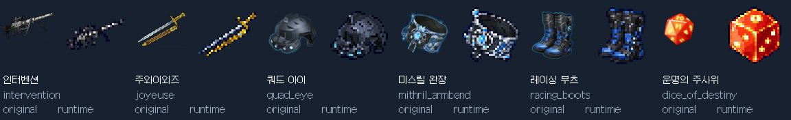

# 장비 확장과 치명타 피해

v1.0.1에서 장비를 51종에서 57종으로 늘렸습니다. 지원하는 23개 무기군 모두 전설 또는 초월 무기를 제작할 수 있으며, 무기 장착 시 해당 무기군의 D 카드가 자동으로 덱에 들어갑니다. 알렉스 패시브의 다른 무기군 D 카드 지급도 동일하게 적용됩니다.

| 장비 | 부위 / 재료 | 게임 내 기본 옵션 | 원작에서 유지한 특징 |
|---|---|---|---|
| 인터벤션 | 저격총 / 미스릴 | 공격력 +4, 치명타 확률 +6% | 공격력과 치명타 확률에 집중한 저격총 |
| 주와이외즈 | 레이피어 / 미스릴 | 공격력 +2, 회피율 +3%, 치명타 확률 +4%, 치명타 피해 배율 +5%p | 기동성과 치명타 확률·피해량을 함께 높이는 레이피어 |
| 쿼드 아이 | 머리 / 미스릴 | 공격력 +1, 치명타 확률 +6% | 연장 총열: 두 턴마다 첫 일반 공격의 추가 피해 +3 |
| 미스릴 완장 | 팔/장식 / 미스릴 | 공격력 +1, 턴 시작 방어도 +1, 치명타 확률 +6% | 이동 기술로 가벼운 발걸음을 쌓고 일반 공격으로 소모 |
| 레이싱 부츠 | 다리 / 운석 | 회피율 +6%, 치명타 확률 +6% | 기동성과 치명타 확률 중심의 신발 |
| 운명의 주사위 | 팔/장식 / 포스코어 | 공격력 +1, 치명타 확률 +5%, 치명타 피해 배율 +8%p | 치명타 확률과 치명타 피해량을 함께 높이는 장식 |

기존 유성검에는 치명타 피해 배율 +6%p, 빛의 증표에는 +4%p를 추가했습니다. 치명타 확률 장비는 13종, 치명타 피해 장비는 4종입니다. 치명타 확률은 원작 수치보다 낮은 4~6%로 조정했으며, 피해·방어·이동 속도·공격 속도·시간 단위 효과는 덱 빌딩 전투에 맞춰 바꿨습니다. 실제 원작 수치의 복제가 아닌 특성의 보존을 기준으로 했습니다.

## 치명타 계산

치명타는 일반 공격 카드에만 적용됩니다. 기본 피해 배율은 150%이며, 장비의 치명타 피해 배율 보너스를 퍼센트포인트로 합산합니다. 예를 들어 주와이외즈(+5%p)와 운명의 주사위(+8%p)를 장착하면 163%가 됩니다. 피해 계산은 일반 공격의 기본 타격에 이 배율을 적용하고 소수점을 버린 뒤, 패시브 등의 추가 피해와 방어도를 계산합니다. 별도 추가 피해·설치물·지속 피해·Q/W/E/R·D·F에는 이 배율을 적용하지 않습니다.

치명타 확률의 합산 상한은 노말·하드 30%, 무한 100%입니다. 치명타 피해 보너스에는 별도 성장 상한을 두지 않아 무한 모드에서 늘어난 장비 슬롯을 활용할 수 있습니다. 동일 장비의 기본 능력치는 합산되며 고유 발동 효과는 중첩되지 않습니다. 상대 실험체 역시 자신의 장비 수치로 계산하며 야생동물은 치명타를 사용하지 않습니다.

장비는 저장된 ID로 정의를 조회하므로 추가된 치명타 피해 옵션 때문에 별도 세이브 마이그레이션은 필요하지 않습니다. 피해 미리보기는 기존처럼 일반 적중을 기준으로 하며, 높은 피해 금지 보스의 경고는 현재 장비를 적용한 치명타 가능 피해까지 확인합니다. 장비 상세·필드 정보에서는 현재의 치명타 피해 배율을 볼 수 있습니다. 제작 검색에는 기존 `치명타` 태그에 더해 `치명타 확률`, `치명타 피해` 태그를 제공합니다.

## 원작 자료와 도트 아이콘

아이템 ID·원작 툴팁·아이콘 원본 URL은 [장비 원작 자료](art-system/equipment-expansion-manifest.json)에 기록했습니다. 프로젝트의 기존 원작 데이터 스냅샷 `items-snapshot.json`을 사용했고, 공식 패치노트로 아이템의 이름과 특성을 대조했습니다.

- 인터벤션 치명타 확률: [공식 1.25 패치노트](https://playeternalreturn.com/posts/news/2014?hl=ko-KR).
- 주와이외즈 치명타 확률·공격 속도: [공식 9.4 패치노트](https://playeternalreturn.com/posts/news/3182?hl=ko-KR).
- 쿼드 아이 공격 속도: [공식 1.49 패치노트](https://playeternalreturn.com/posts/news/2765?hl=ko-KR).
- 미스릴 완장 공격력, 운명의 주사위 치명타 피해량: [공식 9.3 패치노트](https://playeternalreturn.com/posts/news/3163?hl=ko-KR).
- 레이싱 부츠의 전설 등급·운석 재료·치명타 확률: [공식 1.20 패치노트](https://playeternalreturn.com/posts/news/1868?hl=ko-KR). 공격 속도 조정은 [공식 10.4 패치노트](https://playeternalreturn.com/posts/news/3406?hl=ko-KR)와 대조했습니다.

6개 아이콘은 각각 원작 아이콘과 기존 레이더 도트 아이콘을 참고해 built-in `image_gen.imagegen`으로 새로 제작했습니다. 프롬프트는 [생성 기록](art-system/equipment-expansion-generation-records.json)에, 원본 생성물은 `art-system/expansion-generated/`에 보존했습니다. 투명 영역으로 자른 뒤 최근접 보간으로 32×32 논리 픽셀에 맞추고 64×64로 내보냈습니다. 원작 아이콘을 그대로 게임에 넣지 않았습니다.

## 검증

- 모든 23개 무기군을 실제 모닥불에서 제작하고 D 카드 지급·저장 후 재개를 확인합니다.
- 추가 6종의 재료 소모, 제작 횟수, 알렉스 추가 D, 제작 옵션 태그를 확인합니다.
- 플레이어와 상대의 실제 치명타 피해, 일반 적중·스킬 피해 분리, 무한 100% 상한, 기존 저장 ID 조회, 정수 내림, 큰 피해의 오버플로 방지를 확인합니다.
- `Tools/ValidateSystemArt.py`에서 전체 84개 시스템 아이콘과 92개 캐릭터 스프라이트를 검사합니다. 새 6개 아이콘의 투명 여백, 정확한 2×2 픽셀 블록, 서로 다른 원본 생성물, 프롬프트, SHA-256 기록을 포함합니다.
