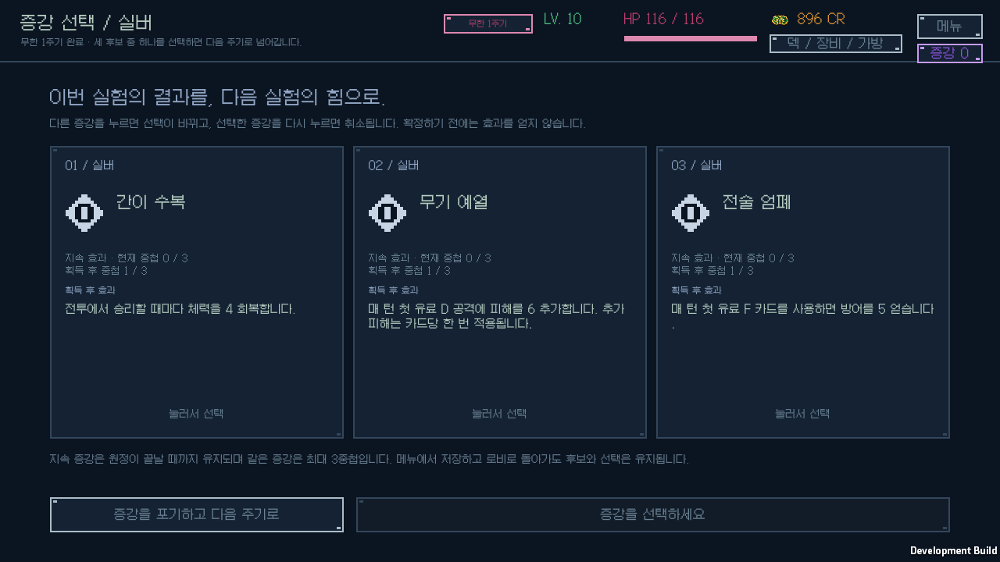
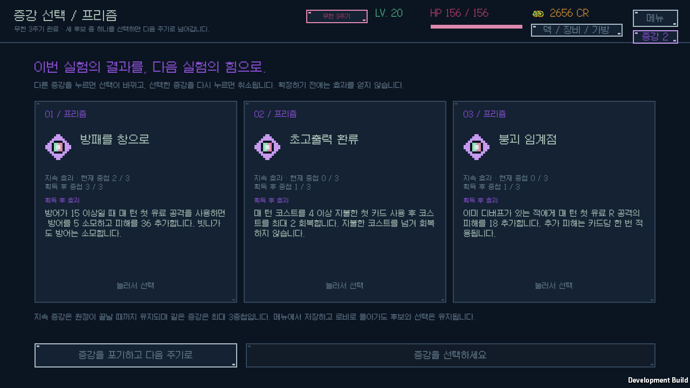
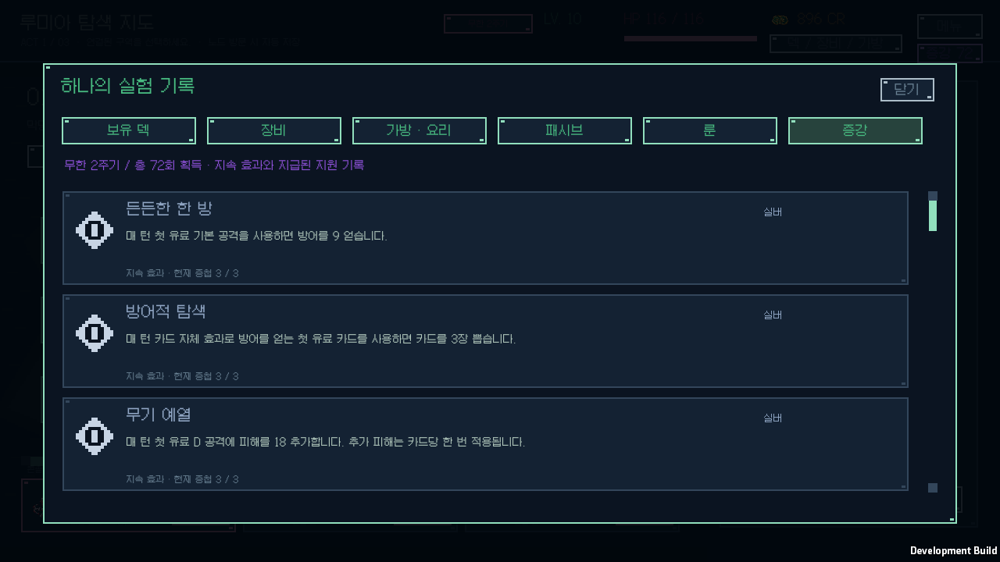

# 무한 증강 검증

검증일: 2026-10-12. Windows, Unity 6000.3.11f1, `v0.1.22`.

무한의 3막 니아 카드·패시브 보상 후 같은 등급 후보 3개 중 하나를 선택하고 확정하거나 건너뛰면 다음 주기로 이어진다. 실버·골드·프리즘 각 9종, 총 27종이다. 첫 세 번은 실버→골드→프리즘, 이후에는 25%·45%·30%로 등급을 추첨한다. 지속 증강 18종은 각각 최대 3중첩이며 즉시 지원 9종은 반복 선택할 수 있다. [전체 효과와 판정 규칙](../ENDLESS_AUGMENTS.md), [모드 규칙](../RUN_MODES.md)에 설명한다.

## 규칙

[코어 검사](core-tests.log): **104개 시나리오·92,734개 단언** 통과. [전체 게임 C# 컴파일](runtime-compile.log) 통과.

- 각 등급·후보 중복 방지·상한에 도달한 지속 효과 제외·모두 수집해도 반복 지원 3선택 유지.
- 보상·패시브 처리 후 증강 진입, 선택 취소·교체·확정·건너뛰기, 한 번만 적용, 다음 주기로 넘어간 뒤 재확정 차단.
- Unity 이어하기에 후보·선택·보유 중첩과 전투의 턴당 발동 한도 보존. 이전 저장에 필드가 없어도 기존 원정을 유지하고 다음 3막부터 증강을 제시.
- 18종의 지속 효과를 실제 전투에서 확인. 유료 조건·혼합 실험체 Q/W/E/R·디버프 선행 조건·카드당 한 번의 추가 피해·기본 공격 치명타와 분리·중첩 후 발동 횟수 유지·환급 상한을 대조.
- 즉시 크레딧·비례 회복·최대 체력 지원, 다음 원정 초기화, 노말·하드 비활성화와 기존 규칙을 확인.

[40시드 노말 자동 플레이](balance.log)는 탈출 2회·패배 38회·정체 0회로 v0.1.21과 모든 결과가 같다. 이는 기존 모드 회귀 검사이며 사람의 무한 모드 승률이나 증강 조합의 완전한 밸런스 추정은 아니다.

## 실제 화면과 저장

[플레이어 로그](ui-player.log)와 [화면 목록](native-screens.json)은 **16개 Windows 화면**, 실제 Galmuri 글꼴 **217개 배치**, 런타임 오류 **0개**를 기록한다. 새 증강 흐름과 기존 모드 해금 흐름을 함께 검증했다. 개인 원정·연구 저장 네 개의 전후 SHA-256이 같고 [개발 빌드](development-build.log)와 [C# 소스 해시](build-source-hashes.json)는 검증 플레이어가 최종 코드와 일치함을 확인한다.

## 배포

[배포 빌드](release-build.log)는 오류 0개로 성공했다. [설치 해시](release-hashes.json) 일치, [시작 확인](release-startup.json)은 정상 응답·실행 오류 0개·개인 원정과 연구 프로필 보존을 통과했다.

[ZIP 검사](archive-validation.json): 런타임 **181개 파일**의 CRC·SHA-256·경로·누락·추가 파일과 개인 저장 제외를 검사했다. 크기 **93,929,280바이트**, SHA-256 `812d1b2773c9397f5658320a3366473d07c17a6197210ea67de3338a38a1563b`.

[v0.1.22 다운로드](https://github.com/JSKS17/BlackTheSurvival/releases/tag/v0.1.22)에서 ZIP 전체를 압축 해제한 뒤 `BlackTheSurvival.exe`를 실행한다.
