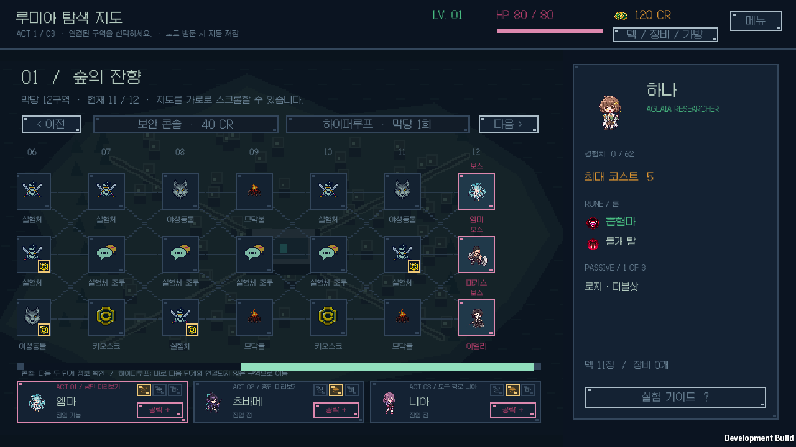
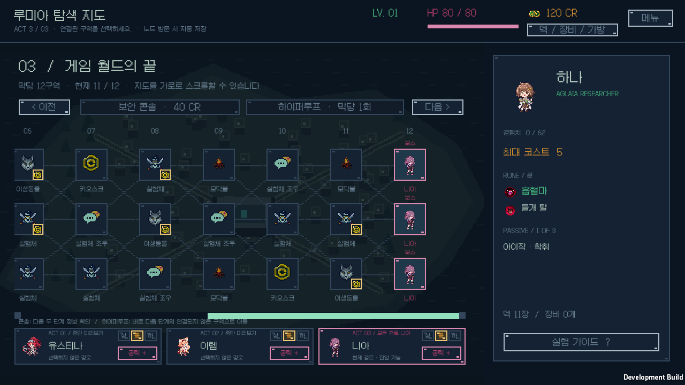

# 경로별 보스 배정과 미리보기

v0.1.18 · 2026-10-12 · Windows · Unity 6000.3.11f1.

1·2막의 세 보스 구역에 각각 다른 실험체를 배정한다. 두 막의 여섯 보스도 중복되지 않으며 니아는 제외한다. 사용자 요청에 따라 3막은 세 경로 모두 최종 보스 니아로 유지한다. 각 막에서는 실제로 선택한 경로의 보스 한 명을 처치하고 다음 막으로 진행한다.

지도 아래 기존 ACT별 보스 패널에서 상·중·하를 선택해 해당 경로의 이름·스프라이트·공략과 개별 상태를 확인한다. 지도 노드도 같은 실험체를 표시한다. 처치 완료는 실제로 방문·승리한 보스 노드에만 표시한다. 미리보기는 UI 선택으로 현재 위치·경로·원정 상태·저장·난수를 바꾸지 않는다. 실제 진입은 기존 연결선과 하이퍼루프 조건을 따른다.

배정은 `MapNode.assignedOpponent`에 저장하고 `bossAssignmentVersion=1`로 관리한다. 원정 생성 때 독립 시드로 확정하며 노드별 조회·이어하기·전투 진입에서 다시 뽑지 않는다. 전투·보상·패시브는 실제 선택한 노드의 보스에 맞춘다. 일반 실험체 정찰도 같은 필드를 쓰지만 보스 배정 보수는 보스 노드만 대상으로 한다.

이전 저장에서는 진행 중 적과 명시적인 유효 노드 배정, 방문·처치 이력을 우선 보존한다. 기존 막별 대표 보스는 실제 진행한 경로에 보존하며 경로 이력이 없으면 중앙에 남기고 다른 경로를 채운다. 기존 전투·보상·패시브 선택·체력·크레딧·카드·난수는 바꾸지 않는다. 예외적인 구형 3막에서 이미 진행한 비니아 보스는 유지하고 미진행 3막은 니아로 고정한다. 새 저장의 유효 배정은 유지하며 손상·중복된 미진행 배정만 보수한다. [보스 공략과 호환 규칙](../BOSS_MECHANICS.md)에 상세 내용을 기록한다.

핵심 규칙은 **75개 시나리오·72,480개 단언**을 통과했다. 여러 시드에서 9개 노드의 확정·재현, 1·2막 여섯 명의 중복 방지, 모든 3막 경로의 니아, 각 노드의 미리보기·공략·실제 입장 일치와 저장 복원을 검사했다. 이전 전투·보상·패시브 선택, 방문 경로와 대표 보스 이관, 명시적 노드 우선 보존, 손상 배정 복구의 반복 안정성도 포함한다. 각 경로에서 실제 승리·보상·패시브·최대 코스트·다음 막·최종 탈출을 확인하며 가지 않은 형제 경로는 처치로 표시하지 않는다. 연결되지 않은 경로의 일반 진입은 거부하고 실제 하이퍼루프만 허용한다. [코어 로그](core-tests.log), [런타임 컴파일](runtime-compile.log)에 기록한다.

같은 고정 자동 정책의 40개 시드는 탈출 2회·패배 38회·정체 0회였다. 이전 버전은 탈출 1회·패배 39회였다. 보스 배정 변경으로 상대와 이후 난수 경로가 달라지므로 이 결과를 사람의 승률이나 개별 기믹 난도의 차이로 해석하지 않는다. [자동 플레이 로그](balance.log)에 실제 결과를 보관한다.

실제 Windows 개발 플레이어에서 **14개 화면·45개 노드 진입·45개 미리보기·52개 저장 복원·실제 승리 4회**를 확인했다. 5개 시드의 경로별 배정과 기존 저장 이관을 Unity JSON으로 검사했고, Galmuri 글꼴로 이름·상태 등의 **207개 배치**를 측정했다. 실행 오류 0개이며 검증 전후 개인 이어하기 저장의 해시가 같다. 검증은 전용 저장 슬롯을 사용한다. [화면·흐름 집계](native-screens.json), [플레이어 로그](ui-player.log), [화면 14개](native-ui/)에 결과를 보관한다. 빌드 복사본과 실제 소스의 SHA-256도 [모두 일치한다](build-source-hashes.json).

1막의 서로 다른 후보, 3막의 세 니아, 선택하지 않은 형제 경로의 미처치 표시와 선택한 후보의 공략 화면을 직접 확인했다. 화면 준비 단계에서도 새 경로용 70개와 기존 보스용 120개 구성을 통과했다. [경로 준비 검사](fixture-preflight.log), [기존 보스 준비 검사](legacy-fixture-preflight.log)에 결과를 보관한다.

Windows [개발 빌드](development-build.log)와 [배포 빌드](release-build.log)는 모두 `LUMIA BUILD Succeeded / errors=0`이다. 배포용 `boot.config`에 개발 플레이어 연결 설정이 없음을 확인했다. 설치한 EXE·Unity 런타임·게임 어셈블리·리소스 4개는 [빌드 출력과 SHA-256이 일치한다](release-hashes.json). 실제 실행 창 제목은 `Black The Survival`이고 응답 정상·시작 오류 0개·개인 저장 해시 보존을 확인했다. [설치 기록](release-install.json), [실행 확인](release-startup.json), [실행 로그](release-player.log)에 근거를 보관한다. Burst 비활성화는 빌드 프로세스에만 적용했으며 원본 프로젝트 설정은 유지했다.

`BlackTheSurvival-v0.1.18-Windows-x64.zip`은 **92,974,818바이트**이며 런타임 **181개 파일** 전체의 CRC·SHA-256·누락·추가 파일 검사를 통과했다. 개인 저장과 Unity 캐시는 소스·ZIP에 포함하지 않았다. [아카이브 검증](archive-validation.json)에 해시와 파일 수를 기록한다. ZIP의 모든 파일을 같은 폴더에 압축 해제한 뒤 `BlackTheSurvival.exe`를 실행한다.
