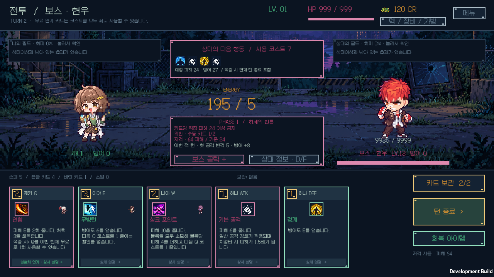
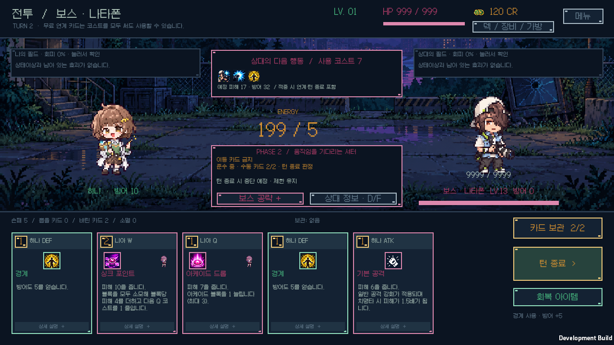

# 보스 대응 조건 확장

v0.1.17 · 2026-10-12 · Windows · Unity 6000.3.11f1.

91명·183페이즈의 기존 보스 중 15명·16페이즈를 변경했다. 대응 종류는 7종에서 11종으로 늘었다. [전체 보스 공략](../BOSS_MECHANICS.md)에 실험체별 예고·조건·실패 효과와 판정 범위를 기록한다.

| 새 대응 | 적용 페이즈 |
|---|---|
| 디버프 기술 사용 | 캐시1·비앙카2·요한2·엘레나2 |
| 디버프 기술 금지 | 마이2·하트2 |
| 강한 직접 공격 금지 | 현우1·니키1·다니엘1·마이1·알론소1·클로에2 |
| 이동 카드 금지 | 카티야1·나타폰2·아델라1·헨리2 |

금지형은 예고 턴에 수동 카드를 최소 2장 사용하고 끝까지 금지를 지켜야 성공한다. 턴 종료 때 확정하며 두 장 사용 후에도 위반하면 실패한다. 한 번의 위반은 이후 방어·피해로 되돌릴 수 없다. 금지 카드를 사용해 전투를 계속할 수 있으며, 실패하면 기존의 제한된 특수효과가 발동한다. 디버프 사용형은 기술 1회 또는 기존 피해 대체 조건으로 대응한다.

디버프 분류는 카드의 구조화된 효과 정의를 공통으로 사용한다. 조건부·예약 효과를 가진 Q/W/E/R·D·F도 포함하며, 실제 명중과 적용 여부 대신 수동 사용을 센다. 기본 공격·경계에 패시브가 붙이는 디버프는 제외한다. 이동 금지는 카드의 이동 표시를 사용한다.

강공 금지는 카드 한 번의 실제 직접 체력 피해와 방어도 흡수의 합을 검사한다. 다단 공격과 카드에 붙는 보너스·치명타를 반영한다. 회피한 타격·초과 피해·지연·설치물·별도로 발동한 패시브 피해는 제외한다. 1페이즈는 24 이상, 2페이즈는 32 이상이면 위반한다.

보스 상태 버전 2는 사용 횟수·위반 카드·실제 피해를 저장한다. 예전 저장의 변경된 진행 중 도전은 새 예고까지 미뤄 소급 판정을 피한다. 이미 받은 취약 보상·예약 폭발·반격·준비·체력·난수와 카드 계획은 보존한다. 적 행동 예고는 복제한 보스 상태에서 지금 턴을 끝냈을 때의 결과를 계산하며 실제 도전을 확정하지 않는다.

핵심 규칙은 [73개 시나리오·71,676개 단언](core-tests.log)을 통과했다. 0/1/2장 경계, 위반 불가역, 실제 카드 사용, 디버프·이동 분류, 직접 피해 23/24 경계·다단·방어 흡수·회피·보너스, 자동 지속 피해 제외, 예측 비변경·저장 복원·이전 도전 이관·예약 폭발 유지·중복 보상 방지를 확인했다. [런타임 컴파일](runtime-compile.log), [새 60개 화면 준비 검사](fixture-preflight.log), [기존 120개 준비 검사](legacy-fixture-preflight.log)를 함께 보관한다.

40개 시드의 같은 고정 자동 정책은 탈출 1회·패배 39회·정체 0회였다. 이전 버전도 같은 집계였다. 보스 조건에 맞춰 덱을 최적화하는 정책이 아니며 사람의 승률이나 개별 기믹 난도를 추정한 수치가 아니다. [자동 플레이 로그](balance.log)에 원시 결과를 기록한다.

실제 Windows 개발 플레이어에서 91명의 보스 진입·읽기 전용 공략, 13개 동작 흐름과 12개 화면을 검증했다. Unity JSON 파일 저장·복원, 제한 준수·위반·턴 종료 성공·한 장만 사용한 실패와 디버프 사용을 확인했다. 실제 Galmuri11 글꼴의 기본 732개 배치와 가장 긴 카드명을 포함한 금지형 12개 배치를 모두 통과했다. 조건·진행·위반 카드가 세 줄 안에 표시되도록 여백을 확보했다. 모든 화면은 1280×720이고 빈 프레임·실행 오류가 없으며 개인 저장의 전후 SHA-256이 같다. [네이티브 로그](ui-player.log), [화면·저장 집계](native-screens.json), [빌드 소스 일치](build-source-hashes.json), [개발 빌드](development-build.log)를 보관한다.

Windows 배포 빌드는 `LUMIA BUILD Succeeded / errors=0`으로 완료했고 개발 플레이어 연결 설정이 없다. 설치한 실행 파일·Unity 런타임·게임 어셈블리·리소스의 해시가 배포 출력과 같다. 실제 게임 창은 정상 응답하며 시작 오류가 없고 개인 이어하기 저장은 설치·시작 후에도 유지됐다. [배포 빌드](release-build.log), [설치 해시](release-hashes.json), [실행·저장 확인](release-startup.json)을 보관한다.

[v0.1.17 Windows 배포](https://github.com/JSKS17/BlackTheSurvival/releases/tag/v0.1.17)의 ZIP은 **92,967,864바이트·런타임 181파일**이다. 모든 파일의 CRC·SHA-256, 실행 파일의 루트 배치, 누락·추가 파일과 개인 저장 제외를 확인했다. [ZIP 검증](archive-validation.json)을 보관한다. 모두 압축 해제한 뒤 `BlackTheSurvival.exe`를 실행한다.
