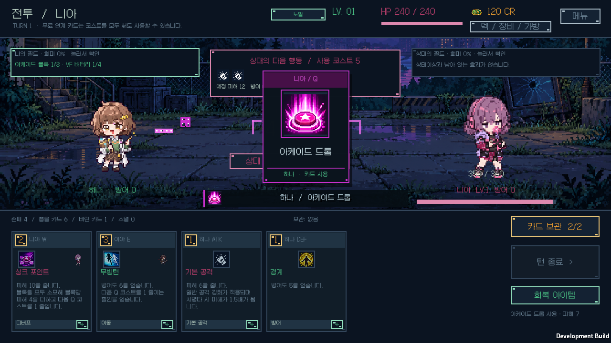
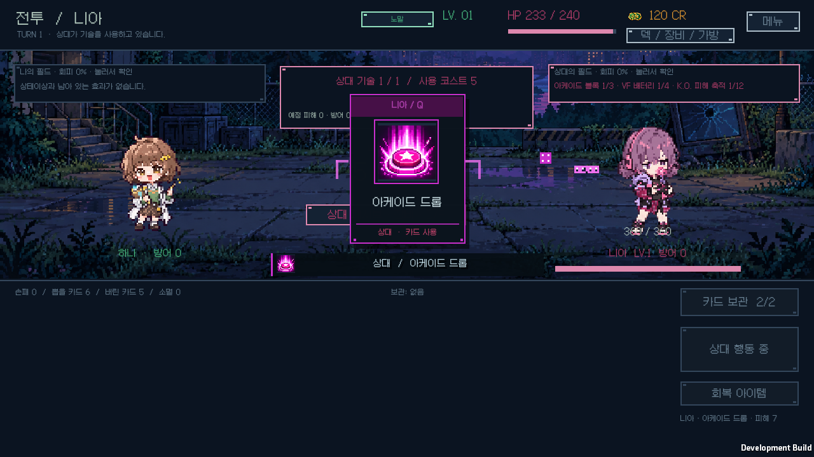
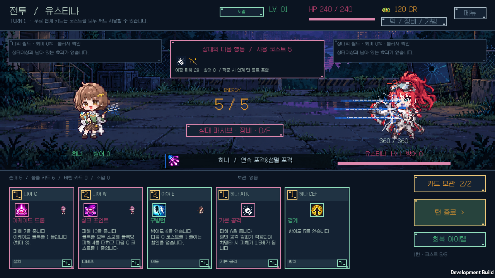
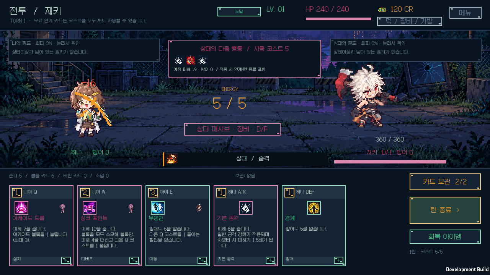

# 카드 확대·기술별 도트 공격·이동 연출 검증

검증일: 2026-10-13. Windows, Unity 6000.3.11f1, `v0.1.24`.

플레이어와 상대 실험체의 직접 카드 사용에 약 0.3초의 확대 안내를 추가했다. 스킬 아이콘·원작 실험체·기술 키·카드명·시전자를 표시하며, 카드 비용은 할인이나 무료 사용과 혼동되지 않도록 이 안내에 중복 표시하지 않는다. 기존 손패의 요약·분류·상세 버튼과 기본 스프라이트 크기는 유지한다.

[원작 참고와 기술별 규칙](../COMBAT_VISUALS.md)에 따라 카드 392종을 32계열의 공격 모양과 개별 팔레트로 표현한다. 돌진·후퇴·도약·순간이동·회전과 잔상, 피격 반응을 양측에 반대 방향으로 적용한다. 준비·이동·적중·잔상 순서로 재생하며, 피해 숫자는 타격 시점에 표시한다. 지속 피해·패시브·룬·장비 발동은 직접 카드 사용과 구분하여 확대 카드를 다시 띄우지 않는다.

## 코드와 규칙

[전체 게임 규칙 검사](core-tests.log)는 **109개 시나리오·97,661개 단언**을 통과했다. [전체 런타임 C# 컴파일](runtime-compile.log)도 통과했다. 새 검사는 카드 전체의 유효한 시각 프로필·원작 기술의 형태·팔레트·캐시 안정성·이동 판정 일치, 프로필 조회 전후 카드 정의와 원정 난수가 동일한지 확인한다.

연출이 피해·체력·코스트·스택·타격 횟수·상태이상·덱·보상·저장 구조를 변경하지 않는다. 입자의 수는 실제 공격 횟수를 의미하지 않는다. 화면 확대를 읽을 짧은 시간 동안만 카드 사용과 턴 종료 입력을 잠그고, 상세 조회·보관 선택·가방 기능은 유지한다. 적 행동은 기존 순서대로 하나씩 재생한다.

스프라이트 원본과 얼굴 픽셀은 수정하지 않았다. 기본 표시 영역은 하나 214×215, 상대 218×216이며, 연출 중 위치·작은 기울기·잔상만 적용하고 시작·종료 시 원래 위치로 돌아온다. ‘움직임 줄이기’에서는 확대·이동·기울기·잔상·피격 반동 없이 짧은 정적 안내와 숫자를 사용한다.

출력은 최대 18개 활성 효과, 입자 최대 18개, 선 분할 최대 180개로 제한한다. 도형은 전투 화면 안에 그려 손패와 상단 정보 영역을 보호하며, 연출 후 GUI 변환·색·활성 상태와 전달받은 글꼴 스타일을 복원한다. 이 제한은 성능 보호 장치이며 모든 PC의 프레임률을 보장하는 측정값은 아니다.

## 실제 Windows 화면

[실행 로그](ui-player.log), [전체 검증 커버리지](coverage.json), [화면 목록·해시](native-screens.json)에 결과를 기록한다. **392종 × 양측의 합성 행동 렌더러 검사**, 32개 계열과 주요 이동을 포함한 **실제 전투 UI 46장**, 실제 Galmuri 글꼴의 카드 안내 **2,352개 배치**를 통과했다. 합성 행동 검사는 기술의 화면 표현을 전수 확인하기 위한 것이며 실제 피해를 다시 계산하지 않는다.

별도로 실제 `PlayCard`와 `AdvanceEnemyAction` 경로에서 양측 카드 사용이 올바른 직접 행동을 생성하고 확대 안내로 이어지는 것을 확인했다. 시작·복귀 위치, 중간 이동 좌표, 양측 동시 연출, 확대 뒤 입력 해제, 모션 감소, 부가 효과의 확대 억제, 애니메이션 전후 게임 상태와 GUI 복원도 검사했다.

카드 확대·모션 감소·이동·복귀·동시 효과 화면 14장과 모양별 대표 32장을 직접 열어 검토했다. 총탄·연속 사격의 타격이 몸체에 묻히던 부분은 짧은 탄도 잔상·외곽 타격 섬광·분산 타격점으로 보강했다. 진한 파란색 효과도 카드명은 읽을 수 있도록 하단 배너 글자를 밝게 표시한다. 효과 자체와 아이콘의 원작 팔레트는 유지한다.

개발 실행은 `-bts-effects-verify` 플래그와 원정·연구의 별도 검증 저장을 사용한다. 개인 원정·연구 파일 4개의 실행 전후 SHA-256이 같고, 실행 오류는 0개다. [개발 빌드](development-build.log)와 [소스 해시](build-source-hashes.json)는 검증 플레이어와 최종 소스의 일치를 확인한다. 검정·오래된 캡처를 통과 근거로 사용하지 않았다.

## 배포

[배포 빌드](release-build.log)는 오류 0개로 성공했다. [설치 해시](release-hashes.json)가 일치하고 [시작 검사](release-startup.json)는 정상 응답·실행 오류 0개·개인 원정과 연구 프로필 보존을 통과했다. [ZIP 검사](archive-validation.json)는 런타임 181개 파일의 CRC·SHA-256·누락·추가·경로와 개인 저장 제외를 확인했다. 크기는 92,682,065바이트이며 SHA-256은 `485f02bc000e4ead9b416743bb9b60ae88f2df621326ab9a91bd649b4d76d5e7`이다. [v0.1.24 Windows 다운로드](https://github.com/JSKS17/BlackTheSurvival/releases/tag/v0.1.24)의 ZIP 전체를 같은 폴더에 압축 해제한 뒤 `BlackTheSurvival.exe`를 실행한다. 기존 원정과 연구 기록을 보존한다.
