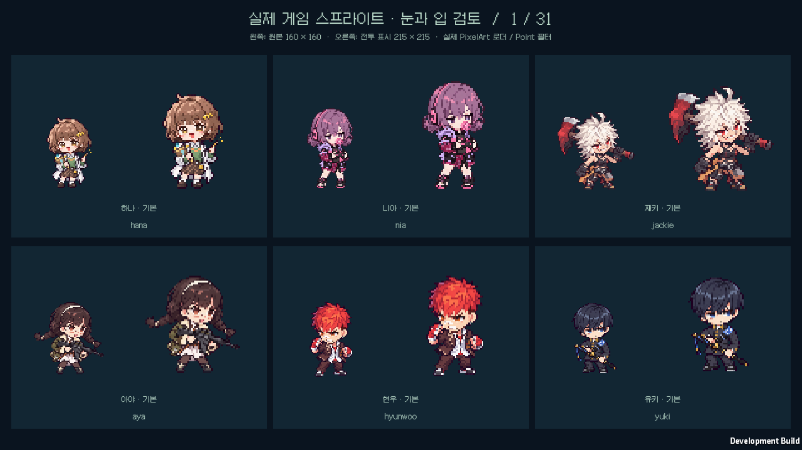
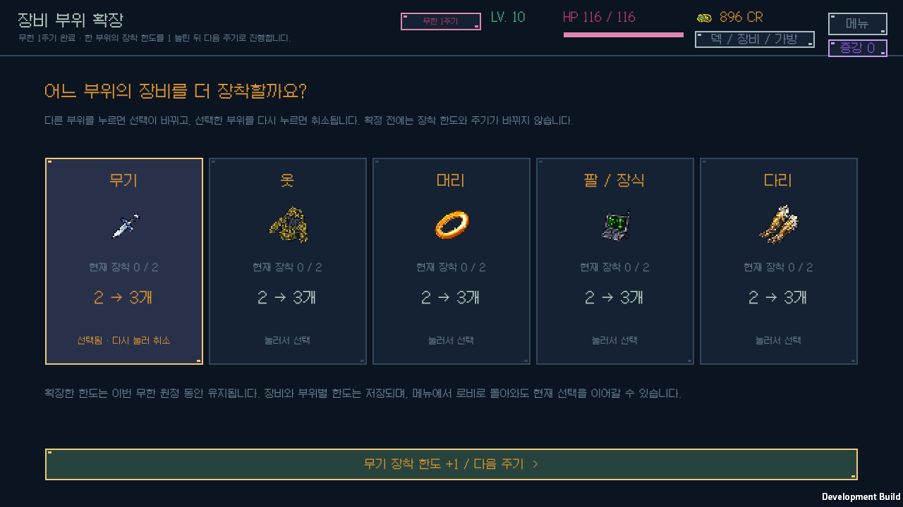
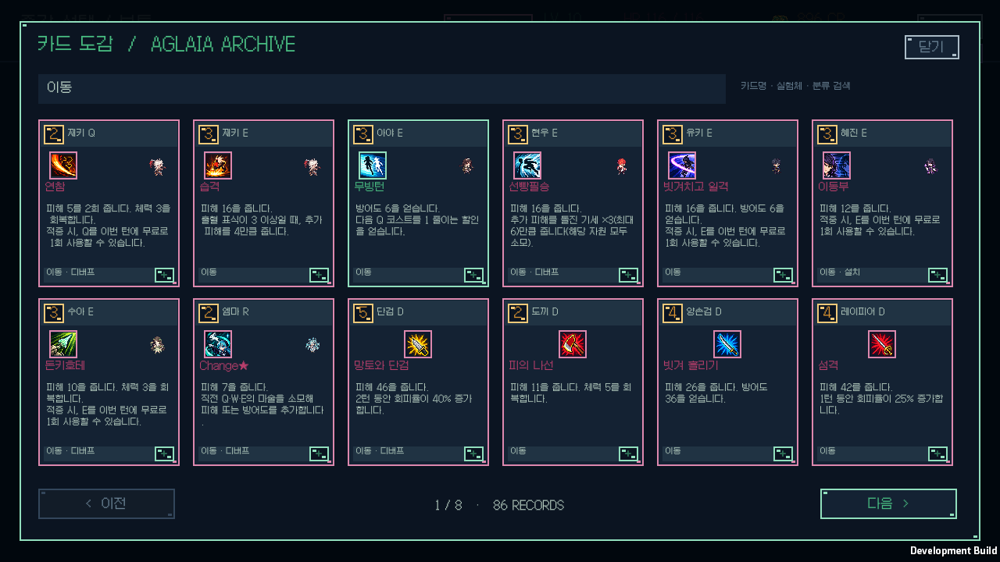

# 얼굴 가독성·카드 분류·무한 장비 성장 검증

검증일: 2026-10-12. Windows, Unity 6000.3.11f1, `v0.1.23`.

실제 게임이 사용하는 기본 92종과 레어 스킨 91종을 전수 검토하고, 140종의 눈·입을 286개 논리 픽셀에서 보정했다. 카드 조건은 “…일 때, …”로 표시하며, 카드 아래에 이동·설치·디버프 등 해당 분류를 문자로 표시한다. 무한 모드에서는 3막 완료마다 증강 선택 다음에 한 장비 부위의 장착 한도를 1 늘린다. 증강 등급의 표시 이름은 보통·희귀·전설이다.

## 얼굴과 크기 보존

[얼굴 보정 제작 기록](../art-face-refinement/README.md), [183종 보존 검사](../art-face-refinement/validation.json), [전후 비교 18장](../art-face-refinement/comparisons/)을 보관한다. 160×160 캔버스와 80×80 논리 격자, 모든 알파 바이트와 검토한 눈·입 픽셀 밖의 색상, Unity GUID·Point 필터 등 import 설정이 원본과 같다. 원본 생성 그림과 프롬프트를 보존하고 보정 이력을 별도로 연결했다. UI 표시 크기와 포즈·몸체·복장·헤어 외곽·무기·여백은 바꾸지 않았다.

캐릭터의 개별 눈매와 표정, 풍선껌·치아·안경·수염·가면·앞머리·모자로 인한 가림을 유지했다. 이미 읽을 수 있는 얼굴 43종은 그대로 두었다. 기본·레어 전수 검토와 전후 대조표를 직접 검토했으며, 자동 픽셀 검사는 캐릭터의 닮음을 판정하는 도구로 사용하지 않았다.

[실제 게임 로더 로그](face-player.log), [로더 커버리지](face-coverage.txt), [네이티브 얼굴 화면 31장](native-faces/)에서 기본 92종·레어 91종의 리소스가 모두 전용 이미지로 로드되는 것을 확인했다. 각 스프라이트를 원본 160px와 전투 표시 215px에서 직접 검토했다. 비검정·서로 다른 31장, 총 366개 표시에서 흐림·누락·잘림을 발견하지 못했다. 숨김 창의 최초 검정 캡처는 검증에 사용하지 않고 실제 창에서 다시 촬영했다.

## 규칙과 설명

[코어 검사](core-tests.log)는 **108개 시나리오·94,476개 단언**, [설명 검사](description-audit.log)는 **39,664개 단언**을 통과했다. [전체 런타임 C# 컴파일](runtime-compile.log)도 통과했다.

- 무한 장비 한도는 부위마다 기본 2이며 같은 부위를 반복 선택해 누적할 수 있다. 실제 모닥불 제작·교체와 능력치, 무기마다 제공하는 D 및 알렉스의 추가 D까지 확장 한도를 사용한다. 장비 자체를 무료 지급하지 않는다.
- 선택·취소·교체는 확정 전까지 한도를 바꾸지 않는다. 증강 확정·포기 다음에 부위 선택을 거쳐 새 주기로 넘어가며 중복 확정은 막는다. 새 원정과 노말·하드는 기본 한도 2를 사용한다.
- 구버전의 누락 필드, 잘못된 한도 값과 유한 모드 값을 정규화한다. 신규 저장 단계는 기존 열거형 값 뒤에 추가했다. 증강의 내부 등급 값·ID를 유지하여 기존 보유 증강은 보존한다.
- 별도 읽기 검토와 임시 runner에서 30주기·90보스의 각 보상 경계를 저장·복원하고, 선택 도중 정산·반복 확정·부위별 누적을 971개 추가 단언으로 확인했다.
- [카드 분류 기준](../CARD_CLASSIFICATION.md)은 이동·디버프에 실제 전투와 보스의 판정을 사용한다. 설치는 실제 전장 물체·지대·소환체를 생성하는 규칙에 표시하며 개인 수치·설치물 소비·단순 지연 공격을 구분한다. 분류 표시는 전투 판정을 바꾸지 않는다.
- 조건의 어미와 구두점만 바꿨으며 같은 조건의 효과 묶음, 수치·횟수·쿨다운·요약 길이와 전체 설명 하단의 디버프 정의를 유지한다. 카드 392종·패시브 91종·룬 16종·장비 51종을 설명 검사로 대조했다.

## 실제 UI와 저장

[게임 로그](ui-player.log), [화면 목록과 결과](native-screens.json)는 **30개 Windows 화면**, 실제 Galmuri 글꼴 **621개 배치**, 카드 분류 **392개**, 실행 오류 **0개**를 기록한다. 기존 증강과 모드 해금 흐름, 장비 부위 변경·취소·확정, 선택 중 실제 저장→로비→불러오기, 중복 지급 방지를 확인했다.

장비 21개(무기 9개)를 착용한 인벤토리와 교체 목록의 스크롤을 직접 확인했다. 카드 분류는 별도 글자로 밝게 표시하고 상세 버튼과 분리한다. 요약 모드에는 분류명만, 전체 설명에는 분류 정의와 보스 판정을 표시한다. 도감의 분류 검색과 도움말도 확인했다. 새 분류는 기존 요약 5줄과 스프라이트 표시 영역을 줄이지 않는다.

개인 원정·연구 저장 4개 파일은 격리된 검증 전후 SHA-256이 같았다. [개발 빌드](development-build.log)와 [소스·스프라이트 해시](build-source-hashes.json)는 검증 빌드가 최종 파일과 일치함을 확인한다. 검사 중 개인 저장을 옛 백업으로 덮어쓰지 않았다.

## 배포

[배포 빌드](release-build.log)는 오류 0개로 성공했다. [설치 해시](release-hashes.json)가 일치하고 [시작 검사](release-startup.json)는 정상 응답·실행 오류 0개·개인 원정과 연구 프로필 보존을 통과했다. [ZIP 검사](archive-validation.json)는 런타임 181개 파일의 CRC·SHA-256·누락·추가·경로 및 개인 저장 제외를 확인했다. 크기는 92,652,000바이트이며 SHA-256은 `2bdb1bbfd32c7a6fdad7bfbc4a7cdabe6cae1acd10488b9de61457382a143282`이다. [v0.1.23 다운로드](https://github.com/JSKS17/BlackTheSurvival/releases/tag/v0.1.23)의 ZIP 전체를 같은 폴더에 압축 해제한 뒤 `BlackTheSurvival.exe`를 실행한다. 원정·연구 저장은 유지한다.
