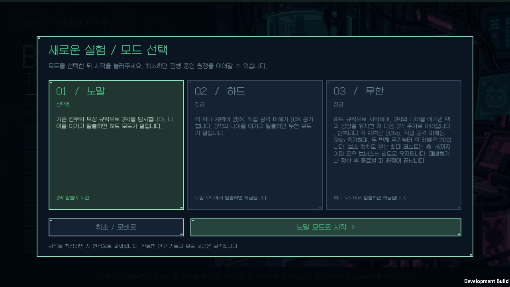
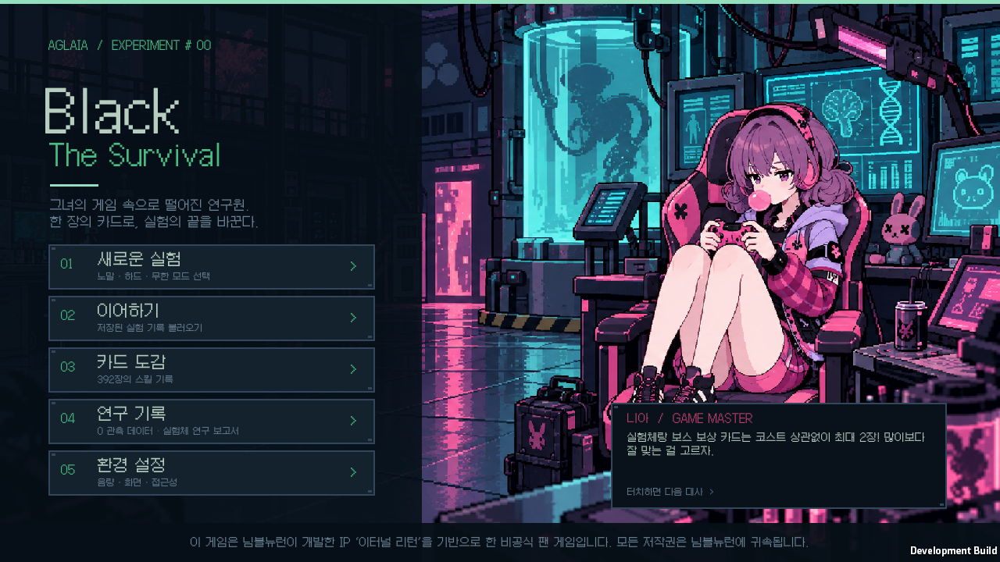
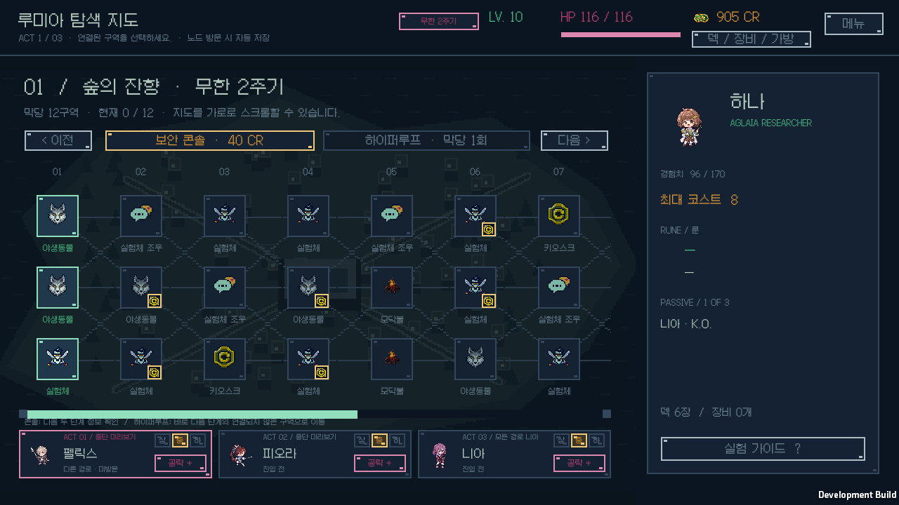

# 로비 대사와 원정 모드 검증

검증일: 2026-10-12. Windows, Unity 6000.3.11f1, 배포 버전 `v0.1.21`.

## 동작

로비에서 니아의 대사창을 누르면 팁 36개와 농담·응원 12개, 총 48개를 순서대로 보여 준다. 마지막 다음에는 첫 대사로 돌아온다. 원작의 게임을 좋아하는 말투를 참고한 팬 창작 대사이며, 최근 재확산 밈과 고전 게임 농담의 [선정 자료와 전체 대사](../LOBBY_DIALOGUE.md)를 보관한다. 클릭은 화면 인덱스만 바꾸며 게임 난수·저장·보상에 영향을 주지 않는다.

새 게임에서 노말·하드·무한을 선택한다. 노말 탈출 후 하드, 하드 탈출 후 무한이 해금된다. 완료한 연구 정산을 영구 저장한 뒤 해금을 공개하며 실패한 저장이나 중복 정산이 해금·보상을 먼저 지급하지 않는다. 기존 연구 프로필에 기록된 탈출은 노말 성공으로 인정한다. 모드 선택을 취소하면 기존 원정은 보존된다.

[모드 규칙](../RUN_MODES.md)에 하드의 적 체력 +25%·직접 피해 +10%, 무한의 3막 반복·주기별 추가 배율·레벨 20 상한·보스 최대 코스트 추가 6 상한·자발 정산을 명시한다. 무한 주기 전환은 마지막 보스의 카드·패시브 보상을 마친 뒤 수행하고 기존 덱·장비·연구와 조우 약속을 유지한다.

## 규칙과 컴파일

[코어 검증](core-tests.log): **96개 시나리오·91,981개 단언** 통과. [전체 런타임 C# 컴파일](runtime-compile.log) 통과.

- 노말의 생성 난수·지도·보스·시작 카드와 기존 행동을 비교했다. 하드와 무한은 야생동물·실험체·보스 체력, 다단 직접 공격의 매 타격 올림, 행동 예고와 실제 피해가 일치한다. 크레딧과 보상 배율은 바꾸지 않는다.
- 노말→하드→무한의 승리 해금, 패배 시 미해금, 기존 프로필·Unity JSON, 저장 실패·파일 잠금 후 재시도·중복 정산을 확인했다.
- 무한에서 마지막 보상·패시브 후 다음 주기로 이동하고, 고유 노드 ID·이전 방문 기록·보스 공략 연구를 보존한다. 재로드가 체력 배율을 두 번 적용하지 않으며 아홉 보스를 이겨도 보스 최대 코스트 증가는 6까지만 적용된다. 조우 증가분은 별도로 유지한다.
- 대사 48개를 모두 순환하고 경계 인덱스·읽기 전용 목록·반복 클릭 후 동일 게임 난수와 다음 조우·실제 규칙에 맞는 팁을 검사했다.

[40시드 노말 자동 플레이](balance.log)는 탈출 **2회**, 패배 **38회**, 정체 **0회**로 v0.1.20과 40개 결과가 모두 같다. 이는 고정된 자동 정책의 회귀 검사이며 사람의 모드별 승률 추정은 아니다.

## 실제 Windows 화면

[네이티브 플레이어](ui-player.log)는 실제 아홉 보스 승리·보상 확정으로 두 해금을 열고 무한의 두 번째 주기·Unity 저장 복원·자발 종료·한 번 정산·이전 JSON을 통과했다.

[화면 목록](native-screens.json)의 **16개 화면**: 대사·최장 대사·잠금·취소·노말 준비/지도/성공·하드 해금/전투/성공·무한 해금/주기/메뉴/확인/종료/복원. 실제 Galmuri 글꼴로 대사·모드 설명·잠금 조건·극값 주기·정산 문구 **61개 배치**를 검사했다. 런타임 오류 **0개**, 개인 원정과 연구 파일 네 개의 전후 해시 일치.

[개발 빌드](development-build.log), [C# 소스 해시](build-source-hashes.json)로 최종 코드와 플레이어 소스가 일치함을 확인했다.

## 배포

[배포 빌드](release-build.log) 오류 0개. [설치 파일 해시](release-hashes.json) 일치, [실행](release-startup.json) 정상 응답·런타임 오류 0개·개인 원정 및 연구 프로필 보존.

[ZIP 검사](archive-validation.json): 런타임 **181개 파일**의 CRC·SHA-256·누락·추가 파일·경로와 개인 저장 제외를 검사했다. 크기 **93,918,515바이트**, SHA-256 `f1ee83569355c3ef68d14ca04d04905ff69a574a706b6fcbf9bdbfbbdc42838a`.

[v0.1.21 Windows 다운로드](https://github.com/JSKS17/BlackTheSurvival/releases/tag/v0.1.21)에서 ZIP 전체를 압축 해제하고 `BlackTheSurvival.exe`를 실행한다.
