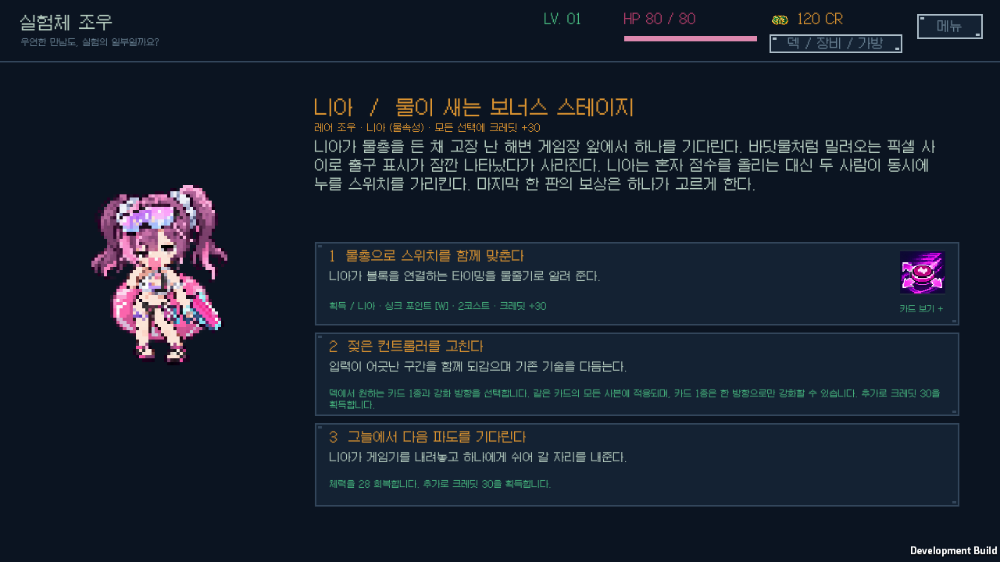
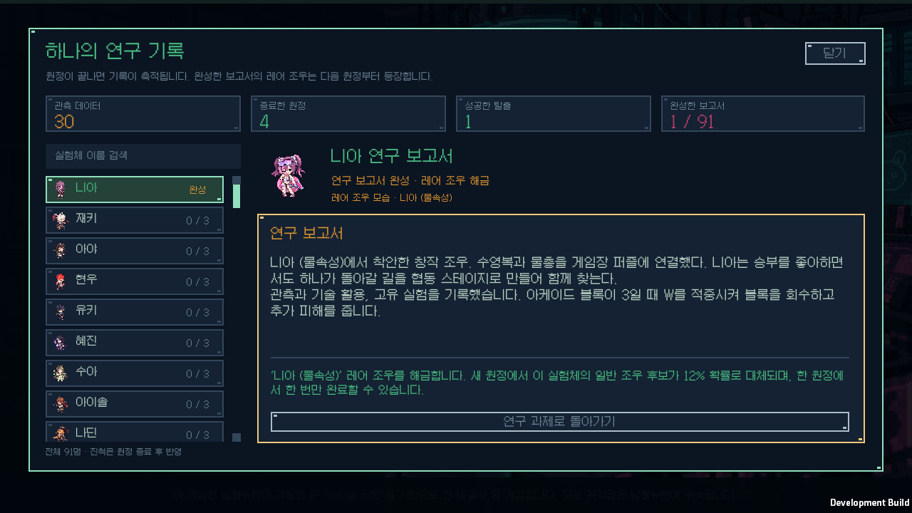

# 레어 조우·최신 스킨 검증

검증일: 2026-10-12. Windows, Unity 6000.3.11f1, 배포 버전 `v0.1.20`.

## 구현과 선정 기준

캐릭터 일지에서 해금하는 추가 사건을 **레어 조우**로 표시한다. 91명의 제목·이야기·보고서·행동 세 가지를 선택한 최신 출시 스킨의 분위기에 맞춰 새로 작성했다. 원작의 공식 사건이나 대사를 복사하지 않은 팬 창작이다. 루치아·세레스·크레이버는 사용자가 요청한 별도 사복 디자인을 사용한다.

[스킨 선정 근거](../art-rare-skins/README.md)에서 공식 출시·보상 일정, 나중에 추가된 색변형, 미출시 외형 제외와 요한의 과거 출시일 예외를 설명한다. [91명 명세](../art-rare-skins/skin-manifest.json)와 [실제 이야기](../../Assets/Scripts/Lumia/RareSkinStories.cs)를 함께 보관한다.

일반 후보가 이미 해금한 실험체일 때 **12%** 확률로 레어 조우로 바뀐다. 이전의 35%보다 낮으며, 보고서 해금 다음 새 원정부터 적용하고 실험체별 원정당 한 번 완료할 수 있다. 약속 후속 조우의 다음 후보 우선권 **80%**와 한 화면의 세 실험체 중복 방지를 유지한다.

모든 성공한 레어 선택에 크레딧 **30**을 한 번 추가한다. 회복은 최소 28·동일 실험체의 일반 최고 회복보다 최소 8 높고, 크레딧 선택은 최소 55·일반 최고 보상보다 최소 10 높다. 거래 가격은 기존 연구 사건의 75%이며, 미래 보너스로 선결제 비용을 충당할 수 없다. 자세한 규칙은 [연구 진행](../RESEARCH_PROGRESSION.md)에 있다.

## 실제 아트와 순수 규칙

레어 스프라이트 **91종**을 built-in imagegen으로 개별 제작했다. 얼굴·선택 스킨·3사복·투명 배경을 대조했고, 80×80 논리 격자를 160×160 PNG로 정확히 2배 확대했다. Point 필터와 압축 없는 Unity import, 고유 GUID, 기본 도트 보존을 검사했다. [아트 검증](../art-rare-skins/runtime-validation.json), [실제 프롬프트·원본·해시](../art-rare-skins/asset-index.json), [기본/레어 비교표 6장](../art-rare-skins/sprite-comparisons/)에 근거가 있다. 제공된 팬 참고 이미지 자체는 재배포하지 않는다.

[코어 검증](core-tests.log)은 **84개 시나리오·86,897개 단언**을, [런타임 C# 컴파일](runtime-compile.log)은 전체 게임 스크립트 컴파일을 통과했다.

- 레어 선택 273개를 실제 엔진으로 적용해 보너스·가격·회복·크레딧·설명을 대조했다. 선택 전에 전체 거래 가격이 필요하며 실패한 선택은 보상이나 완료 기록을 남기지 않는다.
- 선택·재로드·강화 취소·룬 변경 완료에서 추가 크레딧을 재수령하지 않는다. 레어 보상 설정을 다시 실행해도 상향이나 할인이 누적되지 않는다.
- 잠긴 보고서·원정 내 이미 완료한 사건을 제외하고, 약속 조우와 함께 등장해도 세 실험체가 중복되지 않는다. 해금·선택·기존 저장 복원 규칙을 유지한다.
- 91개 이야기·보고서·짧은 미리보기와 기존 사건 ID·선택 순서·보상 필드 보존을 확인했다. 미리보기는 첫 문장만 보이고 선택 후 전체 이야기를 읽을 수 있다.

[40개 시드의 자동 플레이](balance.log)는 탈출 **2회**, 패배 **38회**, 정체 **0회**였다. 연구 해금이 없는 동일 정책에서 v0.1.19와 40개 결과가 같아 기존 전투 진행이 유지됨을 확인했다. 사람의 승률이나 해금 후 레어 선택의 성능 추정으로 해석하지 않는다.

## 실제 Windows 게임

[네이티브 검증](ui-player.log)과 [화면 목록](native-screens.json)은 1280×720 창의 로비·빈 기록·연구 진행·보고서 완성 가능·데이터 부족·보고서 완성·보고서 본문·패배 정산·탈출 정산·레어 조우의 **10개 화면**을 확인했다. 런타임 오류는 **0개**다.

실제 Unity 리소스에서 레어 도트 91개·스킨 이름 91개·선택 273개를 로딩했고, 기본 스프라이트 분리·캐시·누락 시 대체도 확인했다. Galmuri 글꼴로 기존 과제·보고서 **364개**, 레어 해금·스킨 이름 **182개**, 후보의 짧은 이야기 **91개**, 합계 **637개 배치**가 표시 영역 안에 들어감을 확인했다. 개인 원정과 연구 파일 네 개의 전후 해시가 같으며, 실제 정산·저장·해금 흐름과 이전 JSON 여섯 경로도 통과했다.

[개발 빌드](development-build.log)와 [빌드 소스 해시](build-source-hashes.json)는 검증 플레이어가 최종 C# 소스와 일치함을 확인한다.

## 배포 파일

[배포 빌드](release-build.log)는 오류 0개로 성공했다. [설치 해시](release-hashes.json)에서 EXE·Unity 런타임·게임 어셈블리·리소스가 빌드 출력과 같고, [실행 확인](release-startup.json)에서 정상 창 응답·실행 오류 없음·개인 원정과 연구 프로필 보존을 확인했다.

[ZIP 검증](archive-validation.json)은 **181개 런타임 파일**의 CRC·SHA-256·경로·누락·추가 파일과 개인 저장 제외를 검사했다. ZIP 크기는 **93,909,045바이트**, SHA-256은 `994b1b57976cf2777137d7109480ec6882c837a2194e886f52774fd6c30516b0`이다. [v0.1.20 다운로드](https://github.com/JSKS17/BlackTheSurvival/releases/tag/v0.1.20)에서 ZIP 전체를 같은 폴더에 압축 해제한 뒤 `BlackTheSurvival.exe`를 실행한다.
