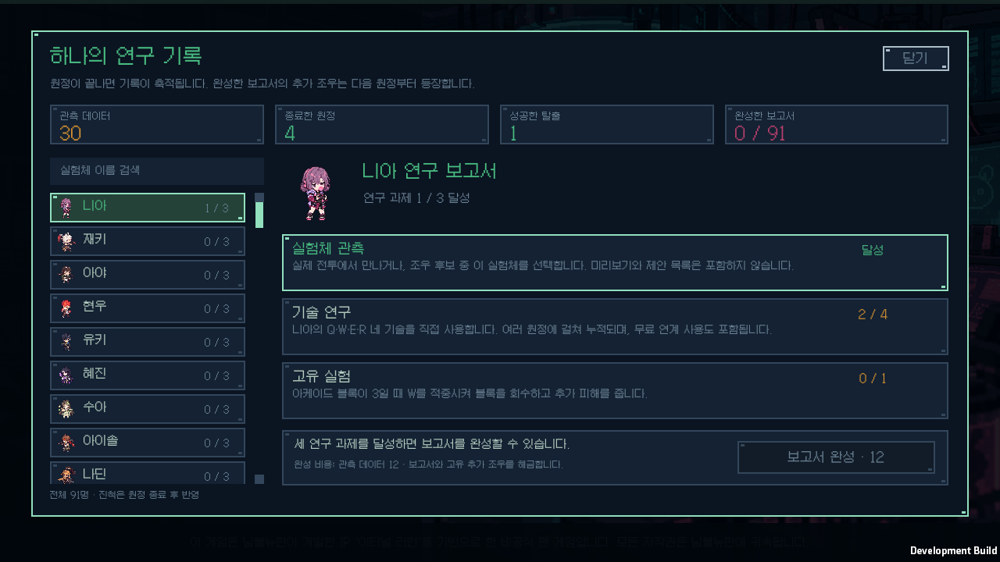
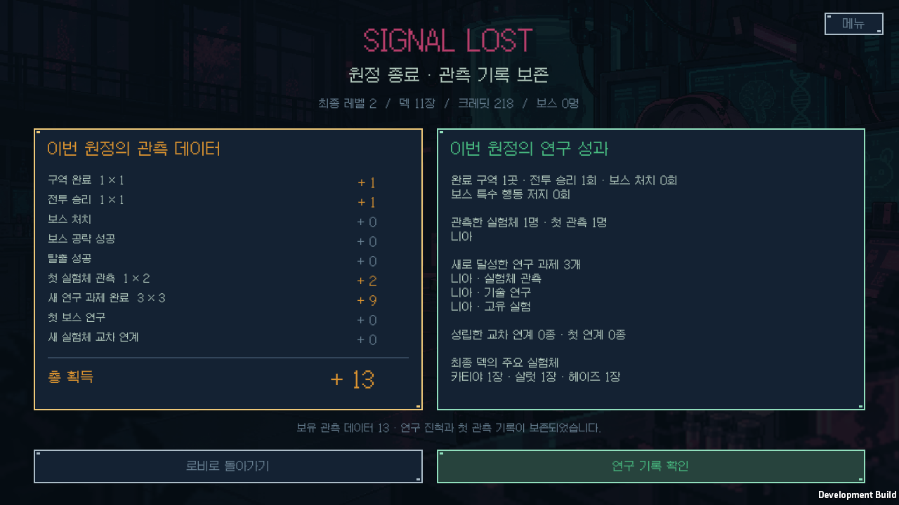
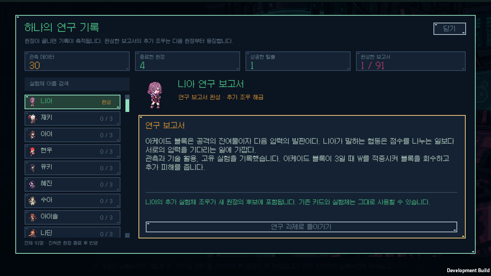

# 관측 데이터·실험체 연구 검증

검증일: 2026-10-12. Windows, Unity 6000.3.11f1, 배포 버전 `v0.1.19`.

## 구현 범위

원정 종료 후 관측 데이터 정산과 실험체별 연구 과제·보고서를 구현했다. 승리와 패배 모두 실제 성과를 지급하고, 로비의 연구 기록에서 진척을 확인한다. 준비 지원·시작 프로토콜·추가 시작 선택·영구 전투 능력치 증가는 추가하지 않았다. 상세 보상과 과제 규칙은 [연구 진행 규칙](../RESEARCH_PROGRESSION.md)에 있다.

91명 모두 관측·Q/W/E/R 사용·고유 실험의 세 과제를 원정 사이에 누적한다. 세 과제와 관측 데이터 12로 보고서를 완성하면 실험체별 추가 조우를 해금한다. 새로 쓴 91개 사건·273개 선택은 다음 새 원정부터 적용하며, 기존 약속 후속 조우의 우선권과 화면 내 실험체 중복 방지를 유지한다.

## 순수 규칙과 저장

[코어 검증](core-tests.log)은 **81개 시나리오·80,382개 단언**을 통과했다.

- 91명 전원의 실제 기술 규칙으로 고유 실험의 성공 증인을 만들고 조건 불충족·상태 변화 없음·적 행동·미리보기는 제외했다. 니아의 최대 블록 W, 아이작의 세 번째 기본 공격 회복과 실제 다른 실험체의 폭탄 자원 소비도 확인했다.
- 구역·승리·보스·페이즈별 공략·탈출과 새 관측·과제·보스·연계를 정확히 정산했다. 같은 보스 페이즈는 반복 지급하지 않으며 니아의 세 번째 페이즈도 포함한다. 패배 정산, 같은 시드의 서로 다른 원정, 중복 재로드와 최근 20개 이력 밖의 정산 기록을 검사했다.
- 프로필을 배타 잠금 아래 다시 읽고 후보 복제본을 원자 교체한 뒤 공개한다. 쓰기 실패 시 데이터와 원정 정산 상태를 되돌리며, 정상 백업 복구·새 형식 쓰기 중단·양쪽 손상 보존·동시 쓰기와 재시도를 확인했다.
- 모든 추가 조우의 273개 선택을 실제 엔진으로 적용하고 저장 복원·해금 전 차단·완료 후 반복 차단·진행 중 원정의 해금 목록 고정과 250개 시드의 후보 구성을 검사했다.

[40회 실제 행동 자동 플레이](balance.log)는 탈출 **2회**, 패배 **38회**, 정체 **0회**였다. 같은 정책의 v0.1.18 결과와 같으며, 연구 기록과 해금이 없는 상태에서 기존 전투와 난수 진행이 유지됨을 확인한다. 이 자동 정책의 결과를 사람의 승률로 해석하지 않는다. 보고서 해금 후의 새 선택지는 실제 효과와 후보 검사로 검증했다.

## 실제 Windows 화면과 전체 흐름

[개발 플레이어 기록](ui-player.log), [화면 목록](native-screens.json), [빌드 소스 해시](build-source-hashes.json)에 근거를 보관한다. 실행 오류는 **0개**이며, 다음 **10개 화면**을 실제 1280×720 창으로 캡처했다.

| 화면 | 확인한 내용 |
|---|---|
| 로비 | 기존 메뉴와 연구 기록 진입 |
| 빈 연구 기록 | 미관측 과제와 보고서 조건 |
| 연구 진행 | 누적 관측과 Q/W/E/R 진척 |
| 보고서 완성 가능 | 세 과제 달성과 데이터 12 비용 |
| 데이터 부족 | 미완성 상태와 구매 차단 |
| 완성한 보고서 | 추가 조우 해금과 읽기 버튼 |
| 보고서 본문 | 고유 관측 메모와 다음 원정 적용 안내 |
| 패배 정산 | 실패해도 데이터와 과제 보존 |
| 탈출 정산 | 보스·탈출·공략과 합계 |
| 추가 연구 조우 | 해금한 사건과 고정 카드 보상 표시 |

실제 니아 기술 사용→승리→패배 정산과 세 보스 승리→탈출, JSON 저장·복원과 중복 지급 방지, 보고서 데이터 차감→재로드→새 원정 해금→실제 추가 조우 선택을 검사했다. 이전 저장에서 연구 필드가 없는 경우와 Unity가 null을 빈 객체로 만드는 경우 각각 승리·패배·진행 중 원정의 여섯 경로를 확인했다. 기존 종료 성과는 소급 지급하지 않고 진행 중 원정은 이관 후 실제 성과만 적립한다. 읽기 전용 프로필도 확인했다.

프로필이 잠긴 채 종료한 원정에서 새 게임을 시작할 때 미정산 원정을 별도 큐에 보존하고, 잠금 해제 후 한 번만 정산함을 검사했다. 엔진을 아직 불러오지 않은 재시작 경로도 포함한다. 원정 저장은 완전히 쓴 임시 파일을 원자 교체하고 정상 백업으로 복구한다. 검증은 전용 원정·프로필·대기 큐만 사용하며 개인 원정·연구 파일의 전후 해시는 같다.

실제 Galmuri 글꼴로 91명 × 과제 세 개·보고서의 **364개 배치**를 측정해 표시 영역 안에 들어감을 확인했다. [사전 검증](fixture-preflight.log), [런타임 컴파일](runtime-compile.log), [개발 빌드](development-build.log)도 통과했다.

## 배포 실행 파일

[배포 빌드](release-build.log)는 오류 0개로 성공했다. [설치 해시](release-hashes.json)는 실행 파일·Unity 런타임·게임 어셈블리·리소스가 검증 출력과 같음을 확인한다. [정상 실행 기록](release-startup.json)은 실제 게임 창의 응답·실행 오류 없음·기존 원정과 연구 프로필 보존을 확인한다.

[배포 ZIP 검증](archive-validation.json)은 **181개 런타임 파일**의 CRC·SHA-256·경로·누락·추가 파일과 개인 저장 제외를 확인했다. ZIP 크기는 **93,023,101바이트**, SHA-256은 `c5bc201072f50c77fc4aef29f18e5234170d1102c6316abdf504c405a1c86543`이다. 배포 파일은 [v0.1.19](https://github.com/JSKS17/BlackTheSurvival/releases/tag/v0.1.19)에 있다. ZIP 전체를 같은 폴더에 압축 해제한 뒤 `BlackTheSurvival.exe`를 실행한다.
