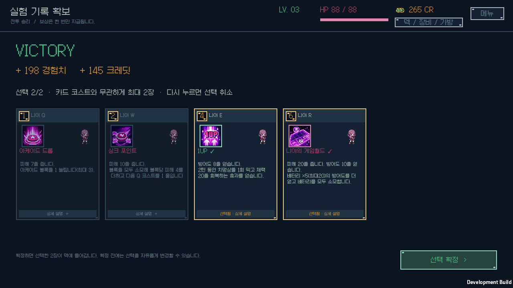

# 실험체 승리 카드 보상 제한

v0.1.16 · 2026-10-12 · Windows · Unity 6000.3.11f1.

일반 실험체와 보스에게 승리하면 제시된 카드 중 코스트와 관계없이 최대 2장을 선택한다. 낮은 코스트 카드도 한 장으로 세고, 높은 코스트 카드 두 장도 함께 선택할 수 있다. 0장이나 1장만 선택하고 진행할 수 있다. 경험치·크레딧·오브젝트·보스 패시브 보상은 기존 규칙을 유지한다.

선택한 카드를 다시 누르면 취소되며 다른 카드로 바꿀 수 있다. 카드의 숫자는 전투에서 사용하는 코스트를 표시한다. 보상 화면에는 선택 수를 별도로 표시하며, 두 장을 선택하면 나머지 선택지는 비활성화된다. 확정 전에는 덱을 변경하지 않고, 확정한 카드는 한 번만 추가한다.

야생동물 보상은 기존 획득 코스트 예산을 유지한다. 낮은 확률의 기본 공격 선택지와 고기 보상에도 기존 규칙을 적용한다.

보상 출처를 저장한다. 이전 저장의 출처 없는 보상은 진행 중인 실제 노드 종류로 복원한다. 이전 미확정 실험체 보상에서 세 장 이상 선택했다면 처음 선택한 두 장만 남기며, 두 장 안에서 다시 선택할 수 있다. 이미 확정해서 받은 카드와 다른 보상은 회수하지 않는다. 버전 1의 클릭 즉시 획득 저장은 먼저 대기 선택으로 이전한 뒤 같은 제한을 적용한다.

순수 C# 규칙 검증은 **70개 시나리오·71,282개 단언**을 통과했다. 91명 모두 일반 실험체·보스로 실제 노드에 진입해 승리한 보상의 출처와 제한을 확인했다. 고코스트 두 장, 세 번째 저코스트 카드 거부, 취소·교체, 0/1/2장 확정, 보스 패시브 선택 중 중복 지급 방지, 버전 1/2의 대기·확정 저장 호환을 포함한다. [코어 로그](core-tests.log), [런타임 컴파일](runtime-compile.log)을 보관한다.

실제 Windows 개발 플레이어에서 다섯 승리 흐름과 **9개 화면**을 확인했다. Unity JSON을 파일에 저장하고 다시 읽어 선택·출처·덱·크레딧·난수 상태가 유지되는지 검사했다. 화면은 모두 1280×720이며 빈 프레임과 실행 오류가 없고, 검증 전후 개인 이어하기 저장의 SHA-256이 같다. [네이티브 실행 로그](ui-player.log), [화면 및 저장 집계](native-screens.json), [실제 빌드 소스 해시](build-source-hashes.json), [개발 빌드 로그](development-build.log)를 보관한다.

40개 시드의 같은 자동 플레이 정책은 탈출 1회·패배 39회·진행 정체 0회였다. 게임 상태를 직접 수정하지 않는 고정 정책의 결과이며 사람의 승률을 추정한 수치가 아니다. [자동 플레이 로그](balance.log)에 기록했다.

Windows 배포 빌드는 `LUMIA BUILD Succeeded / errors=0`으로 완료했다. 설치된 실행 파일·Unity 런타임·게임 어셈블리·리소스의 해시는 배포 출력과 일치한다. 실제 로비 창은 정상 응답하며 시작 오류는 0개이고 개인 이어하기 저장은 설치·시작 후에도 같다. [배포 빌드](release-build.log), [설치 파일 해시](release-hashes.json), [시작·저장 확인](release-startup.json)을 보관한다.

[v0.1.16 Windows 배포](https://github.com/JSKS17/BlackTheSurvival/releases/tag/v0.1.16)의 ZIP은 **92,962,017바이트·런타임 181파일**이다. 모든 파일의 CRC·SHA-256, 실행 파일의 루트 배치, 누락·추가 파일과 개인 저장 제외를 확인했다. [전체 ZIP 검증](archive-validation.json)을 보관한다. ZIP을 모두 압축 해제한 뒤 `BlackTheSurvival.exe`를 실행한다.
