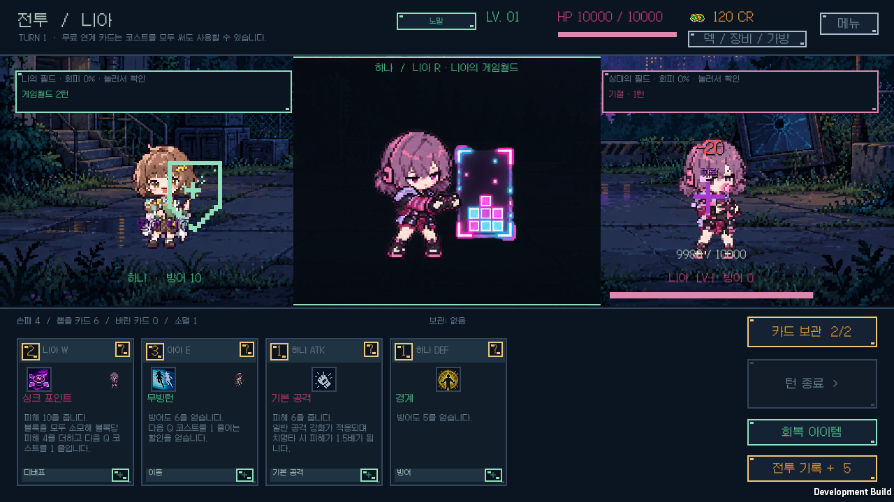
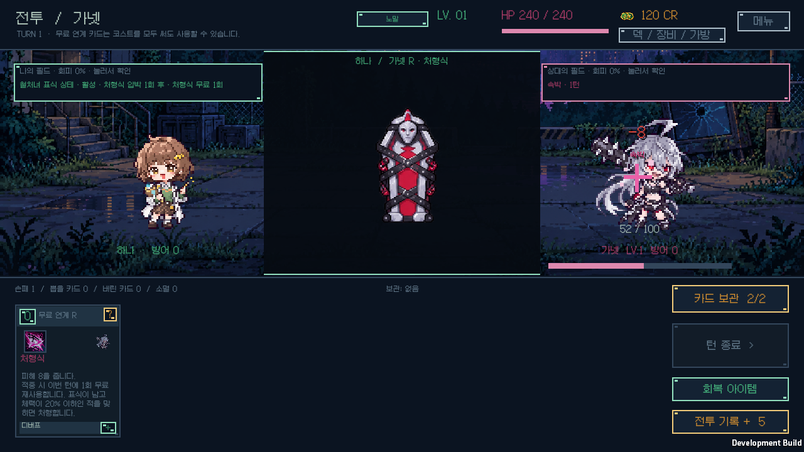
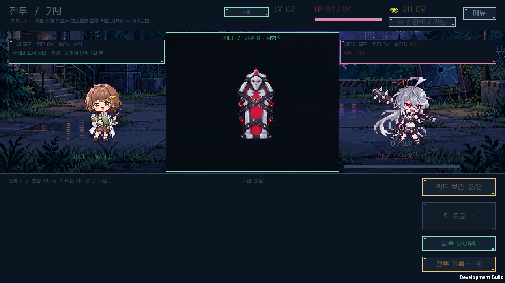

# v1.0.0 검증

Unity 6000.3.11f1의 실제 Windows Player에서 승인된 R 아트를 검증했습니다. 원본 PNG와 런타임 PNG는 SHA-256이 일치하며 이미지를 다시 그리거나 축소하지 않았습니다.

## 게임 규칙과 자산

- 전체 코어: 104,244개 검증, 122개 시나리오 통과.
- 설명 감사: 카드 392종·패시브 91종·룬 16종·장비 51종, 39,665개 검사 통과.
- 런타임 C# 컴파일 통과.
- [원본/런타임 자산 감사](../runtime-ultimate-assets.json): 91종·1,092프레임, 승인 이미지 바이트 일치.
- [Unity 실제 가져오기 감사](../runtime-ultimate-import.json): 91개 텍스처의 크기·Point 필터·알파·밉맵·프레임 경계 통과.
- 가넷의 중복 카드 회수, 같은 턴 무료 재사용, 0코스트 사용, 표식 소비, 재사용 전 정확한 20% 기준, 빗나감, 턴 종료 만료, 소멸, 적 행동·예고, 보스, 기존 치명상 방지와 저장 불러오기를 검사했습니다. [전체 규칙](../GARNET_EXECUTION.md)을 참고하세요.

## 실제 게임 화면

[네이티브 결과](native-ui/coverage.json)는 91명 각각의 플레이어·상대 R 직접 사용 182회, 원본 1,092프레임, 실제 사용 경로를 포함한 배치 검사 3,276회를 통과했습니다.

실제 렌더링한 14개 PNG는 전체 화면과 R 영역의 색상·밝은 픽셀 검사를 통과했습니다. 숨겨진 Windows 창에서 얻은 검정 이미지는 시각 검증으로 인정하지 않았으며, 보이는 게임 미리보기 창에서 다시 실행한 결과를 보관했습니다. 런너도 검정·단색·빈 이미지를 FAIL로 처리합니다.

확인한 항목은 카드 주인에 맞는 R 연결, 카드 확대 후 R 재생, 손패와 겹치지 않는 중앙 영역, 승리·패배 후 결과 화면보다 먼저 마지막 R 재생, 가넷 무료권과 처형, 정적 모션 감소, 재생 중 설정 변경, 일시 정지·재개, 초기화, 1024×768 및 1600×900 배치입니다. 연출이 전투 상태를 바꾸지 않았고 개인 원정·연구 저장과 백업 네 파일의 내용도 동일했습니다.

나머지 캡처는 `native-ui/`에 있습니다. 배포 ZIP의 CRC·파일별 SHA-256·구성 검사 결과는 `windows-package.json`, 최종 빌드와 소스 대응 결과는 `release-build.json`에 기록합니다. 전체 실행 로그는 개인 환경 정보가 포함될 수 있어 공개 소스에 넣지 않았습니다.
