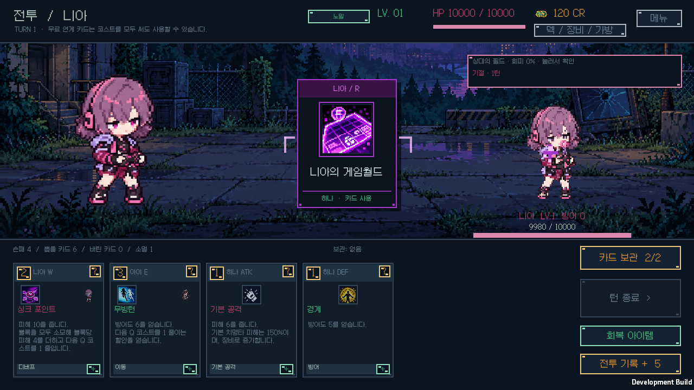
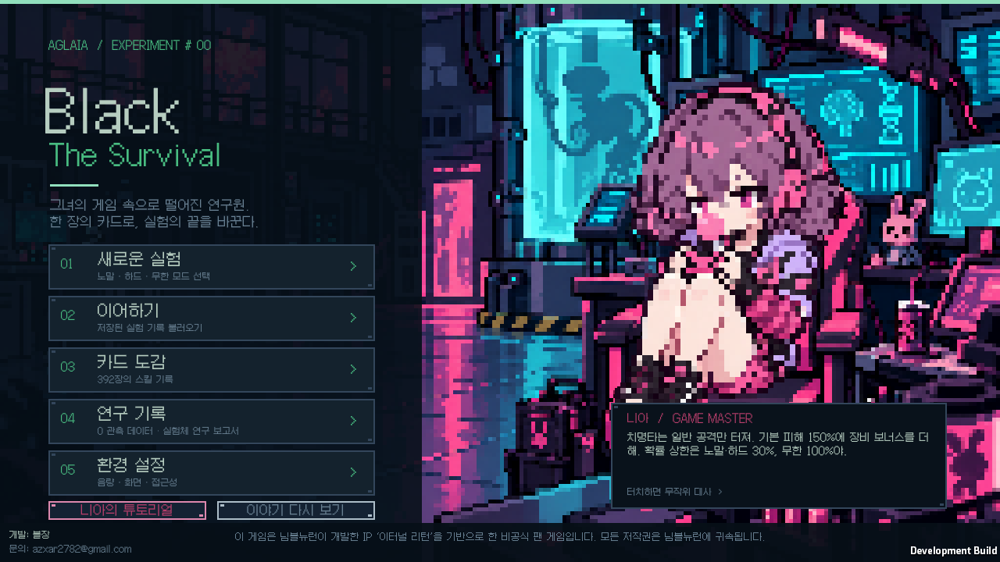
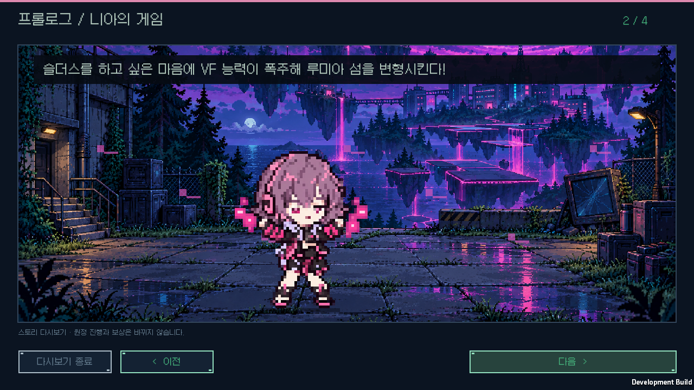

# v1.0.1 검증

Unity6000.3.11f1의 Windows Player와 순수 게임 규칙을 함께 검사했습니다. 이전 저장 경로와 버전 형식은 유지하며, 개인 원정·연구·백업 네 파일의 내용을 비교합니다.

## 규칙과 자산

- 코어105,151개 검증 / 127개 시나리오 통과. 음식2/1코스트, 거부 시 상태 불변, 네 지연 연계의 실제 턴 이동·중복·소멸·저장·적 계획/실행을 검사했습니다.
- 설명39,923개 검사 통과: 카드392·패시브91·룬16·장비57종.
- 모든23개 무기군의 실제 제작·D 자동 지급·저장 재개와 알렉스 추가D를 확인했습니다. 플레이어/상대 치명타 피해, 일반 공격만 적용, 무한 확률100%, 큰 피해 경고·정수 계산도 검사했습니다.
- 전체 시스템 아이콘84개와 캐릭터 스프라이트92개 검사 통과. 새 장비 도트6종의 원작 참고·생성·가공·SHA-256 기록은 [장비 제작 문서](../EQUIPMENT_EXPANSION_v1.0.1.md)에 있습니다.
- 로비와 프롤로그 아트는 내장 imagegen으로 제작했습니다. [아트와 프롬프트](../art-refresh-v1.0.1/README.md), [바이트·알파 감사](../art-refresh-v1.0.1/manifest.json)에 최종 파일을 기록했습니다. 컷신12종의 실제 PNG 해시와 알파 위치도 확인했습니다.
- 승인된 R91종의 원본 PNG는 그대로입니다. Unity 실제 가져오기에서1,092프레임과 Point 필터·크기·알파·밉맵을 검사했습니다.

## 실제 화면

[전투 검사](native-ui/coverage.json)는 양측 R182회,1,092프레임,5,460개 배치 확인과20개 화면을 포함합니다. 카드와 동시 재생, 투명 R·고정 확대·중앙 카드와의 분리, 승리/패배 전환, 일시정지·모션 감소·저장 보존, 테두리 문구의 표시 시간과 별도 줄, 음식2/1코스트와 비활성 상태, 다음 턴 예약·제작 태그를 검사합니다. 캡처 전체와 애니메이션 영역이 검거나 빈 이미지이면 실패 처리합니다.

[로비·컷신 검사](story-ui/results.json)는 로비2개, 컷신12개, 다시보기1개, 치명타 정보8개로 총23개 화면을 통과했습니다. 독립 레이어, 배경256×144/캐릭터80×80 Point 표시, RenderTexture 손실 복구, 내레이션·대사 크기, 저장 후 컷 위치 복원과 개인 저장 불변성을 확인했습니다.

최종 소스와 빌드의 대응은 `release-build.json`, 배포 실행 파일 시작은 `release-startup.json`, ZIP CRC·모든181개 런타임 파일의 SHA-256은 `windows-package.json`에 기록합니다. 배포 ZIP에는 검증 화면·로그·개인 저장을 넣지 않습니다. 사용이 끝난 임시 Unity 검증 프로젝트와 캐시는 정리하며 그 결과는 `storage-cleanup.json`에 남깁니다.
