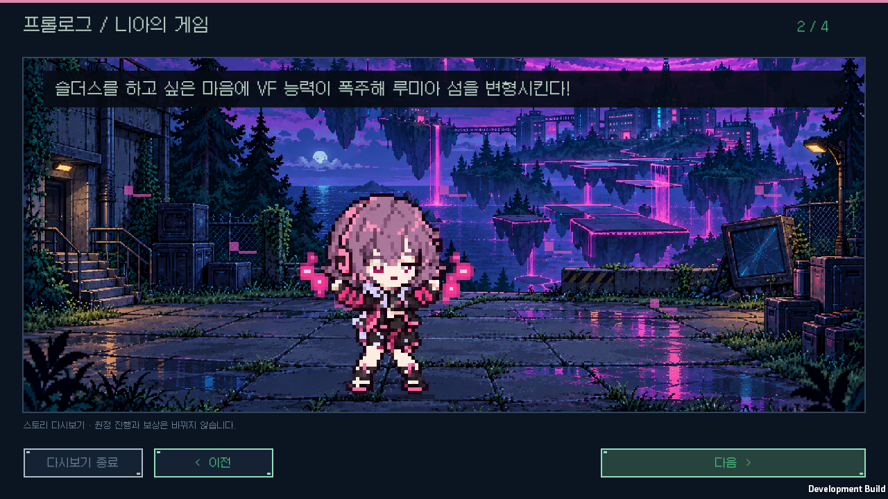
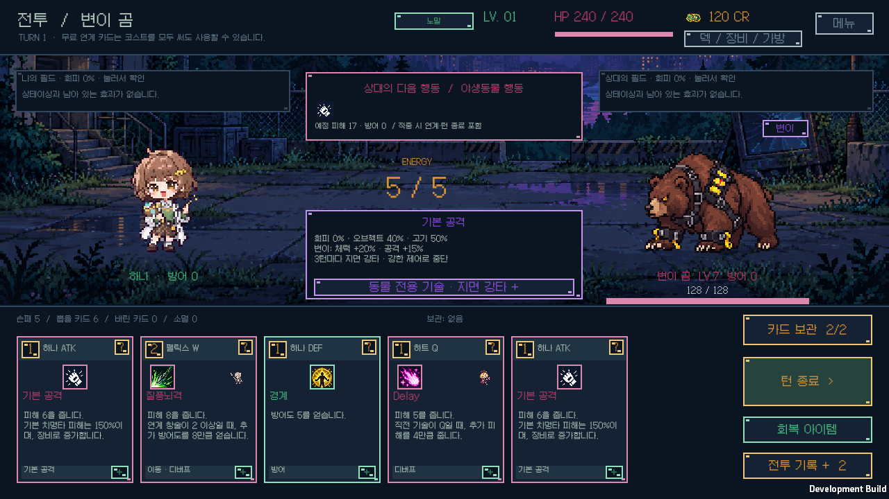
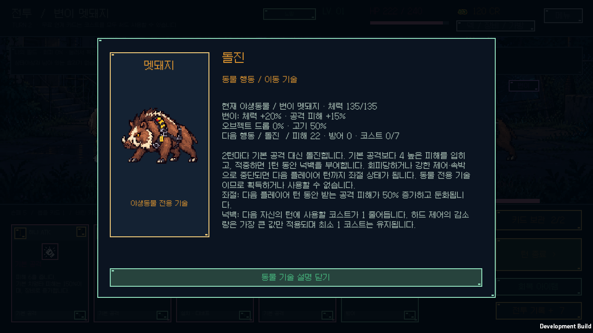

# v1.0.2 검증

Unity6000.3.11f1의 Windows 플레이어와 순수 게임 규칙을 검사합니다. 개인 원정·연구·백업 네 파일은 각 네이티브 검증 전후에 비교하며, 검증은 별도 저장 슬롯을 사용합니다.

## 규칙과 이미지

- 핵심 규칙 **130,594개 / 130개 시나리오 PASS**. 멧돼지·곰의 주기·피해·상태이상·시전 중단·회피·좌절, 변이의 실제 공격과 피해 예고, 저장 복원, 기존 보상과 플레이어 획득 차단을 검사했습니다.
- 설명 감사 **39,923개 PASS**. 플레이어 카드392·패시브91·룬16·장비57종을 유지합니다. 런타임 C# 컴파일도 통과했습니다.
- 독립 구역5,000개씩의 변이 표본은1막0·2막392·3막709개입니다. 예측 조회는 게임 난수를 소모하지 않고, 진행 중 동물의 강화도 다시 적용하지 않습니다.
- [야생동물 아트 검사](wildlife-art.json)는 새 PNG4개, 투명 여백·출력 해시·Point/비압축 가져오기와 들개 아틀라스 보존을 확인합니다.
- 니아는 기존1254×1254 크기와80×80 Point 표시를 유지합니다. 컷신12종의 PNG 해시·알파 위치를 `Tools/BuildStoryGeometry.py`로 확인했습니다. [아트·프롬프트](../art-refresh-v1.0.2/README.md)를 공개합니다.

## Windows 화면과 배포

새 동물의 일반·변이 외형, 전용 기술의 예고·상세·실제 사용·중단, 정찰 지도 **18개 화면 PASS**를 [야생동물 검사](wildlife-ui/coverage.json)에 기록했습니다. [로비·컷신 검사](story-ui/results.json)는 니아 얼굴·독립 레이어·저장 보존을 포함한 **23개 화면 PASS**, [전투 연출 검사](native-ui/coverage.json)는 양측 R182회·1,092프레임·배치5,460회와 **20개 화면 PASS**입니다. 검거나 비어 있는 화면은 실패 처리하며, 세 검사 모두 개인 원정·연구·백업 네 파일을 변경하지 않았습니다.

최종 빌드와 소스의 대응은 `release-build.json`, 배포 실행 파일 시작은 `release-startup.json`, ZIP CRC와 모든 런타임 파일 SHA-256은 `windows-package.json`에 기록합니다. 배포 ZIP에는 검증 화면·로그·개인 저장을 포함하지 않습니다.

배포용 Windows 빌드는 오류0개로 성공했습니다. 시작 검사와 개인 저장 보존도 통과했고, ZIP의181개 런타임 파일을 모두 비교했습니다. 검증을 마친 임시 Unity 프로젝트·캐시와 이전 버전 로컬 ZIP을 정리한 결과는 `storage-cleanup.json`에 남깁니다. 기존 릴리스는 GitHub에서 계속 받을 수 있습니다.
