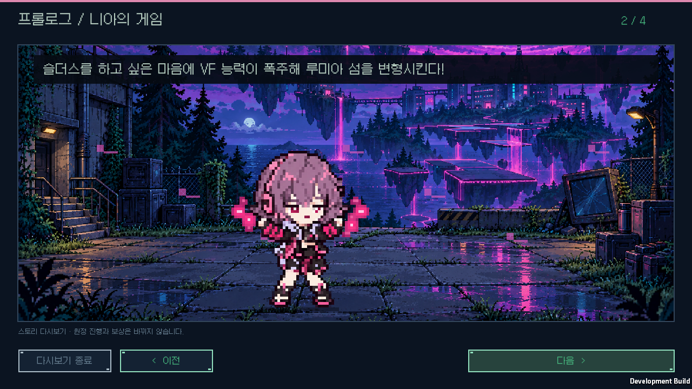
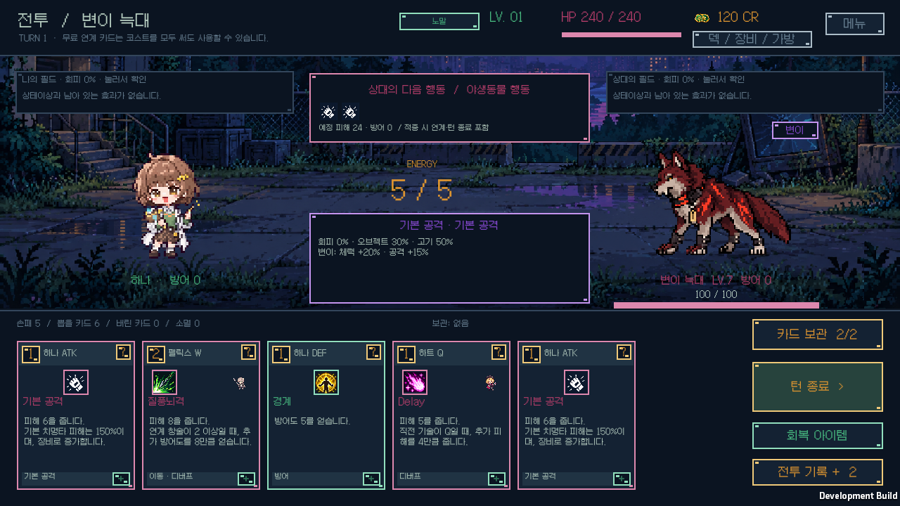

# v1.0.3 검증

변이 동물 전용 도트5종과 프롤로그2 니아의 눈라인을 검사합니다. 능력치·드롭률·전용 기술 등 기존 게임 규칙은 변경하지 않습니다.

`Tools/ValidateMutantWildlifeArt.py`는 새PNG5개와 참고 원작 자료의 해시, 투명도·여백·Point 가져오기, 일반 동물PNG와 들개 아틀라스 불변을 읽기 전용으로 확인합니다. 실제80픽셀 격자에서 일반·변이 이미지가 구분되는지 비교하고, 게임 검증 결과를 `--coverage` 인자로 함께 확인합니다.

니아는 기존1254×1254 원본·80픽셀 Point 표시와 무표정을 유지합니다. 실제로 표시되는 양쪽 윗눈꺼풀의4지점씩을 검사했으며, 평균 RGB 색 거리0.94로 같은 짙은 색입니다. [아트 제작 기록](../art-refresh-v1.0.3/README.md)에 원인과 프롬프트·검사 값을 남겼습니다. 다른 컷신 캐릭터11종은 변경하지 않았습니다.

Windows 개발 빌드의 `-bts-wildlife-verify`는 일반·변이5종, 돌진·지면 강타 예고/상세/사용, 중단과 정찰 지도를 포함한18개 화면을 확인합니다. 전용 이미지의 실제 Unity 픽셀, 변이 저장 후 같은 그림, 기존 전투 표시 영역·Point 격자와 개인 저장 보존을 검사합니다. `-bts-layered-story-verify`는 니아가 나오는 프롤로그를 포함한 로비·컷신23개 화면을 검사합니다. 검거나 빈 화면은 실패 처리합니다.

실제 결과는 `wildlife-ui/coverage.json`, `story-ui/results.json`, `mutant-art.json`에 기록합니다. 최종 빌드-소스 대응은 `release-build.json`, 배포 시작·기존 저장 보존은 `release-startup.json`, ZIP의 전체 런타임 CRC·SHA-256은 `windows-package.json`, 임시 캐시 정리는 `storage-cleanup.json`에 남깁니다.

실제 Windows 화면 **41개 모두 PASS**입니다. 일반·변이 이미지의 구분과 동일 표시 영역, 저장 후 전용 텍스처, 개인 원정·연구·백업4개 파일 보존을 확인했습니다. [실제 니아 눈라인 검사](nia-eye-native.json)에서는 양쪽8개 지점이 모두 짙은 색이며 원본과 화면의 RGB 차이는 최대1, 양쪽 평균 밝기 차이는0.268입니다. 과거 캡처의 같은 위치에서는 한쪽에 피부색이 표시되어 이 검사로 기존 문제도 확인할 수 있었습니다.

첫 개발 빌드는 디스크 공간 부족(Win32 IO112)으로 실패했습니다. 이전 배포본 로컬 사본을 제거하고 임시 Unity 캐시에 NTFS 압축을 적용해 공간을 확보했으며, 같은 소스의 재빌드는 오류0개로 통과했습니다. 소스 이미지의 바이트와 개인 저장은 변경하지 않았습니다. 경과는 `disk-recovery.json`에 기록했습니다.

최종 배포 빌드도 오류0개로 성공했습니다. 실행 시작 검사와 개인 저장4개 보존, ZIP 내181개 런타임 파일의 CRC·SHA-256 전체 비교를 통과했습니다. 검증 화면과 로그·개인 저장은 배포 ZIP에 넣지 않습니다.
